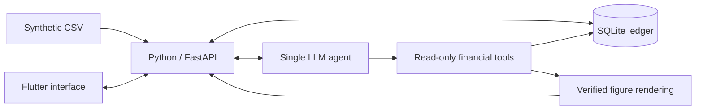

# Shgad (شكد)

An Iraqi Arabic cash-flow assistant for a neighbourhood merchant who tracks cash sales,
customer credit and supplier payments. Shgad aims to turn those records into clear answers
with figures that can be traced back to their source rows.

Built for the Agentic AI Challenge Iraq, Topic 02 (SME & Merchant Assistant).

> **Available now:** a tested backend health endpoint, strict ledger schemas,
> SQLite migrations, deterministic financial primitives and reproducible fictional
> merchant CSVs with independent development truth, a canonical CSV importer and
> a cutoff-safe three-scenario cash-estimate service. Flutter remains a static
> localized shell. Merchant workflows remain planned; no model benchmarks have run.

## Planned features

- Import synthetic CSV records into a validated SQLite ledger.
- Answer everyday financial questions in Iraqi Arabic, with source evidence for every figure.
- Record debts, partial payments, expenses, owner drawings and cash counts through a simple entry form or CSV.
- Keep recorded cash sales separate from unexplained cash differences; never infer the gap's cause.
- Show today's counted cash and debts first, including next-seven-days obligations with confirmed cash versus expected collections.
- Flag unmatched payments and suspected duplicates for review.
- Summarise the week, including estimated gross margin when cost data is sufficient.
- Offer a secondary 30-day cash estimate with base, conservative and stress scenarios and explicit assumptions.
- Preserve saved entries and source evidence through user-initiated undo/void and correction.

## Merchant questions

These examples describe the intended experience:

| Question | Intended answer |
|---|---|
| عندي فلوس تكفي أدفع للمجهز الخميس؟ | Cash available for a supplier payment, separating confirmed cash from expected collections. |
| منو بعده بذمته فلوس؟ | Outstanding customer debts and their due dates. |
| أكو دفعات ما تطابقت؟ | Unmatched payments and possible duplicates, with explanations. |
| شلون كان شغلنا هالأسبوع؟ | A week-to-date summary of sales, collections, spending and estimated gross margin coverage. |
| الشهر الجاي أكدر أوفي التزاماتي؟ | A secondary cash estimate with base, conservative and stress scenarios. |

## Planned architecture



Financial calculations will use integer IQD in Python. The LLM will request validated,
read-only tools and draft explanations with symbolic slots; the backend will fill figures
and dates from verified results. Provider calls and API keys will stay in the backend.

## Development status

The backend requires Python 3.11+ and was verified locally with Python 3.14.7.
From the repository root, create an environment and install the pinned dependencies:

```sh
python -m venv backend/.venv
# Windows PowerShell:
backend/.venv/Scripts/python -m pip install -e 'backend[dev]'
# macOS / Linux: use backend/.venv/bin/python in place of the Windows path.
```

Then, from `backend/`, use that environment's Python:

```sh
python -m pytest -q
python -m ruff check .
python -m ruff format --check .
python -m uvicorn app.main:app --reload
```

Activate the environment first (`.venv/Scripts/Activate.ps1` in PowerShell or
`source .venv/bin/activate` on macOS/Linux). `GET http://127.0.0.1:8000/health`
returns `{"status":"ok","version":"0.1.0"}` without configuration values.
Settings read process environment variables; `.env.example` lists the names.
No `.env` file or provider credentials are needed for health checks. `BUSINESS_AS_OF`
stays unset in raw settings until configured. The domain `BusinessClock.from_settings`
uses the configured date, or **2026-09-28** (synthetic day 90) when absent; it never
uses the server date. Weeks run Saturday–Friday, and naming today's weekday requires
clarification. Baghdad business dates are derived from offset-aware timestamps;
storage uses UTC.

The backend foundation includes strict integer-IQD records, digit/IQD parsing,
and deterministic cash, sales and settlement primitives. Recorded cash sales stay
separate from signed unexplained differences; missing consecutive counts remain
unavailable. Capital injections add cash without sales, revenue or collections.
Drawings remain separate from business expenses.

SQLite schema version 2 has thirteen STRICT tables, with foreign keys, unique
idempotency keys, guarded partial-payment allocations and immutable source evidence.
Difference review and void/correction work at the domain/database level, with client
idempotency and cutoff-aware calculations. Voiding a collection restores outstanding
debt while retaining original transactions, raw rows and linked reason/timestamp audits.
Versioned migrations preserve v1 data and roll back atomically. Unknown opening cash
raises a typed error.

Migrations use the standard-library SQLite driver and require SQLite **3.37+**
(STRICT tables); local verification used SQLite 3.50.4. To create an empty schema,
run this Python from `backend/` with its environment activated:

```python
from contextlib import closing
from app.db.connection import connect_database
from app.db.migrations import apply_migrations

with closing(connect_database("shgad.db")) as connection:
    apply_migrations(connection)
```

This creates the schema only. Merchant-facing import/reconciliation workflows,
financial HTTP endpoints and automatic demo-data loading remain planned.

The Python service `app.services.ingest.import_csv` imports explicitly fictional
canonical CSV files into a migrated SQLite connection. Preload verified categories,
counterparties and opening records separately. It validates UTF-8/BOM files up to
5 MiB / 10,000 rows, normalizes Arabic-Indic amounts, preserves raw cells and errors,
and commits validated rows and quarantine evidence atomically. Explicit compatible
obligation references create payment allocations. Unmatched payments and suspected
duplicates remain flagged for review. Exact file replay adds no transactions,
cash, revenue, obligations or allocations; receipts distinguish accepted, rejected,
exact-duplicate and flagged rows. Column mapping and import HTTP routes are pending.

`app.services.forecast.forecast` reads only a cutoff-filtered SQLite snapshot and
returns 30 integer-IQD daily estimates for base, conservative and stress scenarios.
Recorded sales and signed unexplained differences remain separate drivers; conservative
collections use observed settlement lateness, stress collections are zero, and overdue
receivables are excluded. Unknown starting cash, essential history or due dates produce
typed clarification errors. Later entries, payment links and voids cannot change an
earlier forecast. The service enforces the observed calendar boundary and loads no
files or evaluation answers. Forecast HTTP/UI integration and accuracy evaluation
remain pending.

Seeded fictional data and offline development truth are available. From the
repository root (standard library only):

```sh
python scripts/generate_synthetic_data.py --seed 20260701
python scripts/make_ground_truth.py
```

The generator writes 90 observed days and 30 separate future days for one
fictional shop, plus three shops reserved for frozen final forecast testing.
It constructs daily counts, recorded sales, signed unexplained differences,
capital, credit and supplier settlements, and isolated review/void fixtures.
The independent calculator imports no backend financial services. Its
development expectations include sales, debts, estimated gross margin,
seven-day positions and three forecast scenarios at historical cutoffs.
These are offline reference values; the separate production forecast service uses
the financial specification and SQLite history. Application agent tools remain
pending. Development score windows stop at day 90.

See [data/README.md](data/README.md) for file boundaries and generation
metadata. Same-seed regeneration was byte-identical in a fresh process,
including the manifest. Arabic and plausibility reviews are pending.
Held-out questions remain outside the repository; only the format and a
human-run hash/count helper are prepared. No sealed set or model evaluation
is claimed.

The frontend was verified with Flutter 3.44.9 stable and Dart 3.12.2. It contains a static
chat shell, defaults to Arabic RTL, and also supports English LTR. Cairo is bundled with
its license. Backend requests use one Dio client configured with `API_BASE_URL`;
the static shell does not call the backend or any model provider.

From `frontend/`:

```sh
flutter pub get --enforce-lockfile
flutter gen-l10n
dart format --output=none --set-exit-if-changed lib test
flutter analyze
flutter test
flutter run -d chrome --dart-define=API_BASE_URL=http://127.0.0.1:8000
```

To build the web shell with runtime assets served locally:

```sh
flutter build web --release --no-web-resources-cdn --dart-define=API_BASE_URL=http://127.0.0.1:8000
```

The Android target is scaffolded as `com.aw.shgad`, display name «شكد»; Android builds
and release signing have not been verified. Arabic copy is awaiting Iraqi Arabic review.
No merchant chat, import workflow, ledger HTTP queries, forecast screen or model
integration is implemented yet. Import and forecast currently have Python service interfaces.
Entry, difference-review and void HTTP endpoints, and the next-seven-days view,
remain planned. The tested review/void primitives have no merchant-facing workflow.

Verified locally: **333 backend tests**, including 54 importer/forecast runtime
regressions and 43 offline data/evaluation checks, plus Ruff lint and formatting
for 48 Python files. Financial-rule
regressions were observed failing before their implementation or fix.
To include offline scripts in lint/format checks from backend/, run
`python -m ruff check --config pyproject.toml . ../scripts` and
`python -m ruff format --check --config pyproject.toml . ../scripts`.
Checks include recorded sales and signed differences, capital, review validation,
void-adjusted balances and knowledge cutoffs, v1 upgrades, replay and atomic rollback.
Concurrent review requests cannot explain the same cash twice. No LLM is connected.

Flutter verification: 4 widget tests
(360×800, Arabic/English, text scales 1.0/1.3), Dart formatting and Flutter analysis.
The health endpoint also returned HTTP 200 from a separate clean checkout. The release
web shell launched in headless Chrome without runtime exceptions; RTL screenshots at
normal and enlarged text sizes were inspected. A separate Dio smoke check reached the
running health endpoint using `--dart-define`.

[GitHub Actions](https://github.com/abdulwahed-s/Shgad/actions/workflows/test.yml)
runs backend lint/format/tests and Flutter localization, formatting, analysis and tests
on pushes and pull requests. Its linked run history shows the measured CI results.
There are no financial benchmarks or model evaluations.

Synthetic CSV generation, ledger-import and forecast services are available;
a merchant-facing demo remains pending. No forecast accuracy or model result is claimed.

## Data and scope

All datasets must be fictional. Real customer and transaction records are outside the scope
of this project. The demo will cover one merchant; payment execution and formal tax/accounting
services are outside the planned MVP.

GPT-6.1 Sol drafted the fictional scenario templates. Deterministic seeded Python
generated all numeric records.
The scenario manifest records the drafting brief and the user-confirmed model
display name; the exact provider model ID/settings remain unavailable and are
not guessed. No model-provider API call was used for this dataset.
Application model/API integration remains planned.
