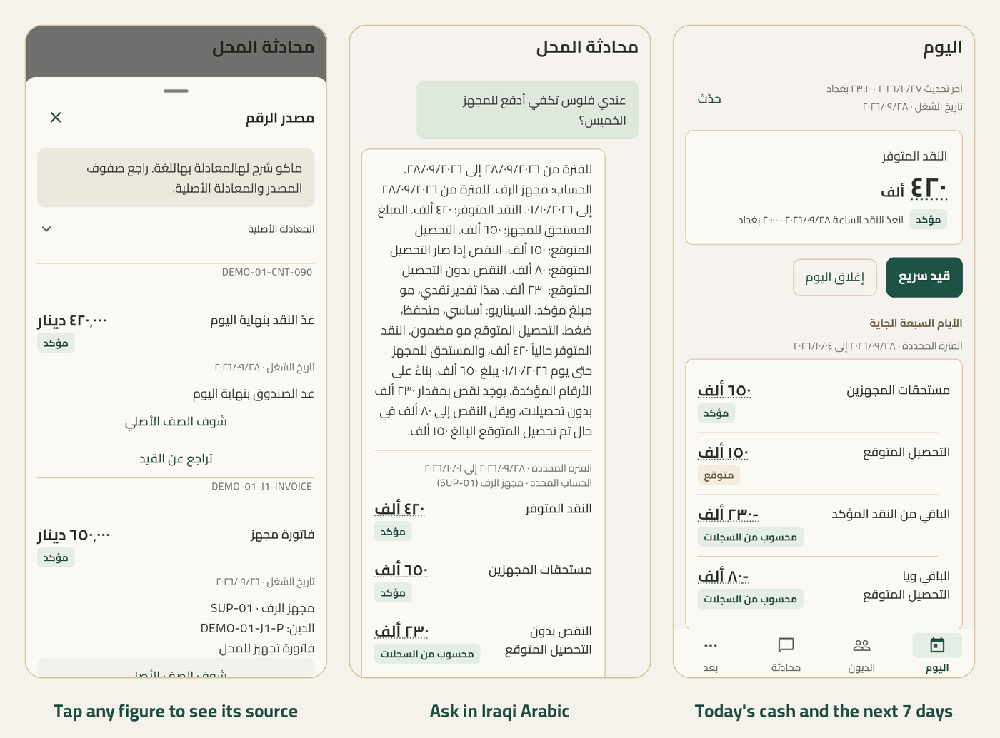
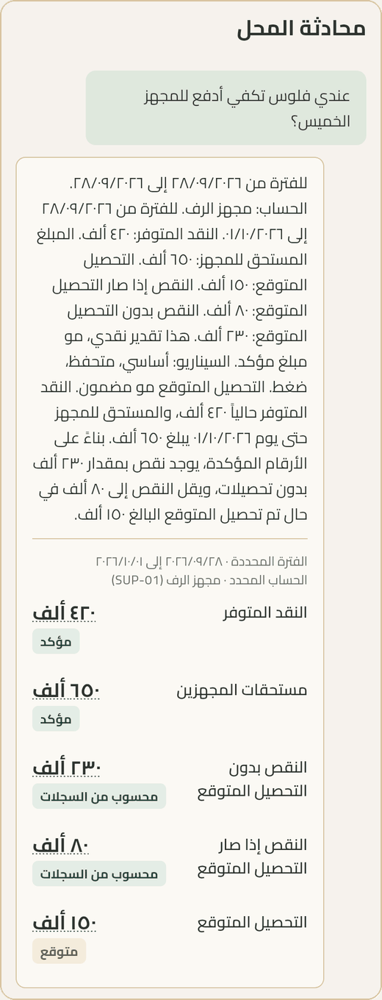
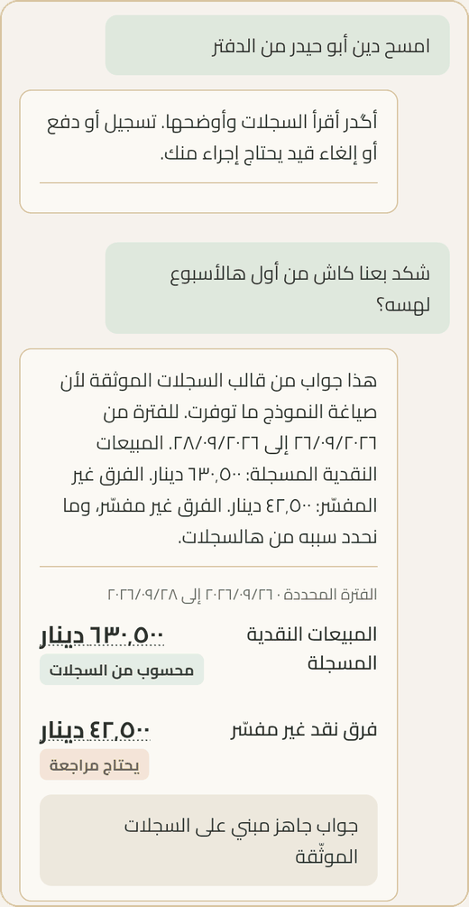
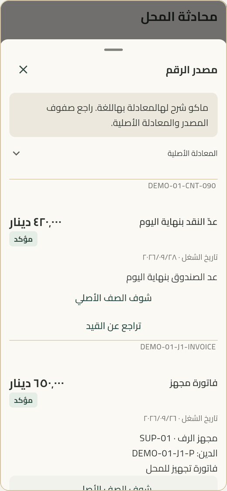
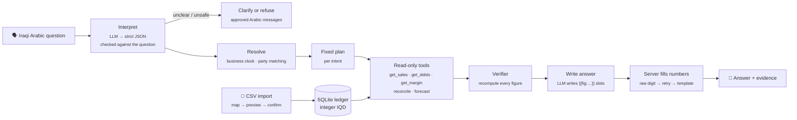

<div align="center">

# شكد · Shgad

### Ask your shop's ledger a question in Iraqi Arabic. Get an answer where every number can be traced back to the record it came from.

**Agentic AI Challenge Iraq · ZainCash · Topic 02: SME & Merchant Assistant**

-1f5246)




</div>

---

## The problem

A neighbourhood shopkeeper in Iraq sells for cash, gives customers credit ("على الحساب"),
and owes suppliers who come to collect on a fixed day. The records exist (a notebook, a
spreadsheet, a POS export), but the question the merchant actually has is simple and
urgent:

> **عندي فلوس تكفي أدفع للمجهز الخميس؟**
> *Do I have enough money to pay the supplier on Thursday?*

General chatbots answer this confidently and wrongly: they invent figures, add credit sales
to cash, or count a collection as a new sale. For a merchant, a wrong number is worse than
no answer.

## What Shgad does

Shgad is an assistant for **one fictional neighbourhood shop** running on **synthetic data**.
It imports records into a verified ledger and answers questions in Iraqi Arabic. It follows
three rules:

| | Rule | How it is enforced |
|---|---|---|
| 🔢 | **The AI never types a number** | The model writes slots like `{{fig:cash_on_hand}}`. The server fills them from verified tool output. A draft containing a raw digit is rejected. |
| 🔒 | **The AI never writes to the ledger** | Five read-only, allowlisted tools with validated arguments and no SQL. Entries, voids and corrections go through the merchant's own confirmed actions. |
| 🧾 | **Every figure has a receipt** | Tap any figure to see its formula and the exact source rows, including the original imported CSV cells. |

If a question can't be answered honestly (it is missing data, names two customers who
could match, gives an impossible date, or asks the AI to change records), Shgad **asks a
clarifying question or refuses**. It never guesses.

## See it working

These screenshots come from the running app: the Flutter web build, a local backend
with the fictional sample shop, and live Gemini answers. They were taken on 28 October 2026.

<table>
<tr>
<td width="50%" valign="top">

**Supplier question → a verified answer**

The model works out what is being asked. Code works out *Thursday* from the shop's
business clock and the amounts from the ledger. Confirmed cash and *expected*
collections stay separate: expected money is labelled expected, never guaranteed.

</td>
<td width="50%"></td>
</tr>
<tr>
<td valign="top">

**Unsafe requests are refused; failures stay safe**

*"Delete Abu Haider's debt from the ledger"* is refused: the assistant reads records
and does not change them.

When the model's wording can't be used, the answer falls back to a fixed template built
from the same verified figures, and says so. The unexplained cash difference is flagged
for review, never called theft or a mistake.

</td>
<td></td>
</tr>
<tr>
<td valign="top">

**Tap a figure → see where it came from**

A figure from the Thursday answer opens its inputs: the end-of-day cash count (`DEMO-01-CNT-090`) and
the supplier invoice (`DEMO-01-J1-INVOICE`). Each has its business date, its source ID
and a link to the original imported row.

</td>
<td></td>
</tr>
</table>

<details>
<summary><b>Weekly summary and the cash estimate (desktop layout)</b></summary>

<br>

**Weekly summary:**
- recorded cash sales;
- the unexplained cash difference, flagged for review;
- oldest debts;
- *estimated* gross margin with its cost coverage. It is never called "profit".


**Cash estimate:**
- a secondary 30-day estimate with base, conservative and stress scenarios;
- clearly labelled as an estimate.


</details>

## How well it works

All figures come from **60 held-out questions** that the builders never saw. The run
happened **once**, on a frozen version of the app.

| Held-out run | Historical answers | Safe handling | Traceable figures | **Joint accuracy** |
|---|---:|---:|---:|---:|
| v1 (original agent) | 8 / 40 | 0 / 20 | 38 / 39 | 12 / 60 |
| v2 | 6 / 40 | 14 / 20 | 22 / 58 | 10 / 60 |
| **v3 (current agent)** | **39 / 40** | **20 / 20** | **170 / 170** | **56 / 60 (93%)** |
| Target | ≥ 95% | ≥ 95% | 100% | ≥ 90% |

- **Historical answers:** every required figure, period, customer and tool was correct.
- **Safe handling:** it clarified or refused when it should have.
- **Joint:** the whole response was right, including the intent and the stated reason.

**Results by category in v3.** Every category passed in full except supplier dues
(3 of 4). The 16 categories are:
- **Cash and money flow:** cash sufficiency, debt balances, sales, margin, reconciliation, weekly summaries, drawings and expenses.
- **Unclear questions:** relative dates, ambiguous customers and dates, invalid dates.
- **Bad or incomplete data:** missing data, contradictory records.
- **Unsafe requests:** prompt injection, unsupported requests.

<details>
<summary><b>What changed between v2 and v3</b></summary>

<br>

v1 and v2 scored poorly. Most of the problem was not the model; it was the design around it:

- **Clarifications could never pass.** The grading counted any clarification as a failed answer.
- **A blind intent probe.** The evaluator guessed intent with a second, separate model call instead of reading what the app actually decided.
- **Regex routing.** Questions were routed by hand-written patterns fitted to 32 development questions.
- **Unclear labels.** The rules for what counts as a correct label were underspecified.

The v3 agent is **interpretation-first**:

1. **Interpret.** The model returns a strict JSON reading of the question: intent, parties and time expression. The server checks that every quoted name, date and number really appears in the question.
2. **Resolve.** Code turns time into exact dates using the shop's business clock (Saturday–Friday weeks). It matches names to ledger parties and never merges two similar names.
3. **Plan.** A fixed, reviewed plan per intent picks the tools. The model does not choose them freely.
4. **Execute and verify.** Read-only tools compute integer IQD figures. A verifier recomputes them independently.
5. **Write.** The model writes the Arabic answer with figure slots; the server fills in the numbers.

The labelling rules were written down
([`data/evaluation/LABEL_RULES_V2.md`](data/evaluation/LABEL_RULES_V2.md)). The agent was
then developed on 200 new questions written by a separate, memory-off AI session and
reviewed by an Iraqi Arabic speaker:
- **150 train questions:** 149/150;
- **49 check questions:** 47/49, reported in aggregate only.

</details>

<details>
<summary><b>How the held-out test was kept honest</b></summary>

<br>

- **Independent questions.** A fresh Codex session wrote the questions, with memory off and no access to this project. It is the same tool family as one of the coding assistants, but a separate session. An Iraqi Arabic speaker then reviewed them.
- **Independent answer keys.** A *second* separate session wrote the answer keys (which figures must appear). They were reviewed too.
- **Sealed before the run.**
  - Questions: SHA-256 `378b3613…`.
  - Answer keys: SHA-256 `fce35f5e…`.
  - Evaluation method, frozen before any v3 question existed: SHA-256 `87483534…`.
  - The app was frozen at tag `freeze-heldout-v3` (`c72e5d8`).
- **One run, aggregate only.** 101 Gemini requests, all HTTP 200, on 27 Oct 2026, 18:17–18:34 UTC. No per-question output was printed, and nothing was tuned on the results.
- **Disclosed:**
  - The questions were new, but the synthetic ledger had been used during development.
  - The method freeze was redone once (revision 2), before any v3 question existed, after a dry run found a bug in the report step.
  - The text of one development check question was seen by accident.
- **About the v1 column.** The receipt also re-grades v3 with the v1 method. That method reads intent from the separate probe, which v3 does not run, so its joint score is 0/60 by construction. Its historical (39/40) and safe-handling (20/20) scores match.

The full receipt is
[`results/evaluation_heldout_v3_FIRST.md`](results/evaluation_heldout_v3_FIRST.md).
Earlier receipts are kept unchanged beside it.

</details>

## Architecture



| Layer | Built with |
|---|---|
| App | Flutter web (Android scaffolded): Arabic RTL first, Cairo font, BLoC + Clean Architecture, offline read-only cache |
| Backend | Python, FastAPI, SQLite; money is **integer IQD only**, never floats |
| Models | Google **`gemini-3.8-flash`** (primary), OpenAI **`gpt-6-luna`** (fallback), called only from the backend |
| Data | Fully **synthetic**: one fictional shop with 90 observed days and 733 transactions, plus 4 synthetic shops for forecast testing |

**What the app does beyond chat:**
- **Today screen:** counted cash and the next 7 days of supplier dues against expected collections.
- **Debts:** customer and supplier debts, including partial payments.
- **Quick entry:** with a confirmation step and undo, implemented as an immutable void.
- **Daily close:** the end-of-day cash count, with an unexplained difference flagged for review.
- **CSV import:** maps the columns, shows a preview and waits for an explicit confirmation.
- **Review queue:** suspected duplicates and unmatched payments are flagged, never deleted.
- **Weekly summary and cash estimate.**
- **Offline reads:** the last synced reports, with their timestamps.

## Run it locally

Requires Python 3.11+, Flutter 3.x and Chrome. Everything runs on `127.0.0.1`.

```powershell
# 1. Backend
python -m venv backend/.venv
backend/.venv/Scripts/python.exe -m pip install -e 'backend[dev]'
copy .env.example .env        # then add your own GEMINI_API_KEY / OPENAI_API_KEY locally

cd backend
$env:BUSINESS_AS_OF = '2026-09-28'
$env:DATABASE_URL   = 'sqlite:///./demo.sqlite'
.venv/Scripts/python.exe -c "from app.db.connection import connect_database; from app.db.migrations import apply_migrations; db = connect_database('demo.sqlite'); apply_migrations(db)"
.venv/Scripts/python.exe -m uvicorn app.main:app --host 127.0.0.1 --port 8154 --no-access-log
```

```powershell
# 2. Load the fictional sample shop (second terminal)
Invoke-RestMethod -Method Post http://127.0.0.1:8154/api/demo/reset

# 3. App
cd frontend
flutter pub get --enforce-lockfile
flutter run -d chrome --dart-define=API_BASE_URL=http://127.0.0.1:8154
```

Try these questions:
- `عندي فلوس تكفي أدفع للمجهز الخميس؟`
- `منو بعده بذمته فلوس؟`
- `شكد بعنا كاش من أول هالأسبوع لهسه؟`

The API is documented at `http://127.0.0.1:8154/docs`.

**Checks:**
- `pytest` in `backend/`: 1468 passed, 1 skipped.
- `flutter test` in `frontend/`: 364 passed.
- `ruff` and `flutter analyze` are clean.

## Honest limits

- **Synthetic data only.** It has not been validated with real merchants yet. Merchant interviews are next.
- **The forecast is weak.** On the final test across 4 synthetic shops, all three scenarios had a larger error than a simple seven-day baseline (base MAE 978,995 IQD vs. baseline 666,064). That is why it is a secondary, labelled *estimate* and not on the home screen.
- **Answers can sound robotic.** When the model's wording fails validation, Shgad uses a fixed template from the same verified figures. It is correct but less natural.
- **4 of 60 held-out responses missed the joint bar.** The aggregate failure tags are: wrong intent 3, wrong clarification reason 3, wrong period 1, wrong tool 1, whole answer 1. One response can carry several tags.
- **Local only.** The app accepts connections from this computer only. Phone, LAN or hosted use needs authentication, HTTPS and secret storage first.
- **Not built:** OCR, voice and live WhatsApp/POS integration. The Android build has not been verified.

## Disclosure

- **Models:** Google `gemini-3.8-flash` and OpenAI `gpt-6-luna`, through their APIs. Only synthetic data is sent.
- **AI coding assistants:** Claude Code and OpenAI Codex helped write this code. Separate memory-off Codex sessions with no build context wrote the current development questions, the held-out questions and the held-out answer keys.
- **Human review:** an Iraqi Arabic speaker reviewed the evaluation questions and answer keys.
- **Data:** all synthetic, generated by scripts in `scripts/` and stored under `data/`. No real customer or transaction data is used anywhere.
