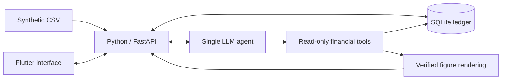

# Shgad (شكد)

An Iraqi Arabic cash-flow assistant for a neighbourhood merchant who tracks cash sales,
customer credit and supplier payments. Shgad aims to turn those records into clear answers
with figures that can be traced back to their source rows.

Built for the Agentic AI Challenge Iraq, Topic 02 (SME & Merchant Assistant).

> **Status: initial repository setup.** The application, demo dataset and tests have not been
> implemented. All features below are planned; no benchmark results or demo are available yet.

## Planned features

- Import synthetic CSV records into a validated SQLite ledger.
- Answer everyday financial questions in Iraqi Arabic, with source evidence for every figure.
- Keep cash, sales, customer debts, supplier bills and owner drawings separate.
- Flag unmatched payments and suspected duplicates for review.
- Summarise the week, including gross margin when cost data is sufficient.
- Project cash flow over the next 30 days, with explicit collection assumptions.

## Merchant questions

These examples describe the intended experience:

| Question | Intended answer |
|---|---|
| عندي فلوس تكفي أدفع للمجهز الخميس؟ | Cash available for a supplier payment, separating confirmed cash from expected collections. |
| منو بعده بذمته فلوس؟ | Outstanding customer debts and their due dates. |
| أكو دفعات ما تطابقت؟ | Unmatched payments and possible duplicates, with explanations. |
| شلون كان شغلنا هالأسبوع؟ | A week-to-date summary of sales, collections, spending and gross margin coverage. |
| الشهر الجاي أكدر أوفي التزاماتي؟ | A cash-flow projection with base and conservative scenarios. |

## Planned architecture

Financial calculations will use integer IQD in Python. The LLM will request validated,
read-only tools and draft explanations with symbolic slots; the backend will fill figures
and dates from verified results. Provider calls and API keys will stay in the backend.

## Development status

Python 3.11+ and Flutter are the planned development prerequisites. SDK versions, installation
commands, demo seed/import instructions and test commands will be added after they are verified.
There is currently no runnable backend, frontend or evaluation harness.

## Data and scope

All datasets must be fictional. Real customer and transaction records are outside the scope
of this project. The demo will cover one merchant; payment execution and formal tax/accounting
services are outside the planned MVP.

Application
model/API integration and synthetic data generation remain planned.
