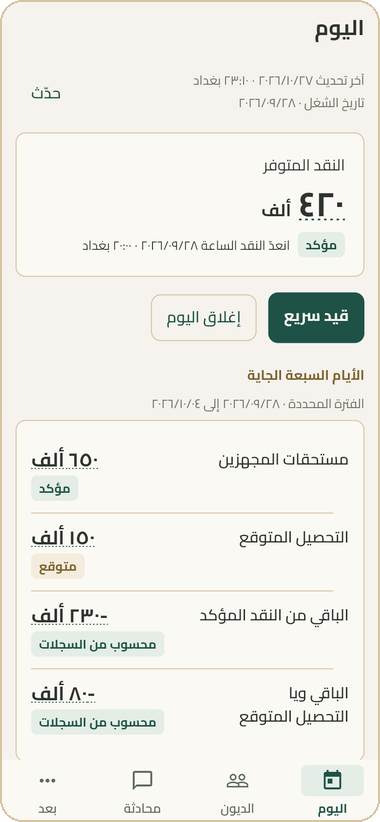
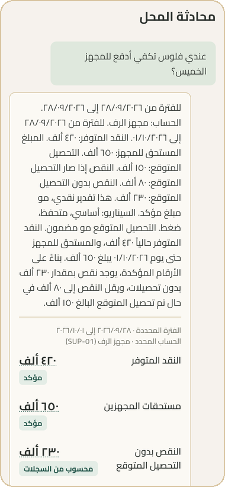
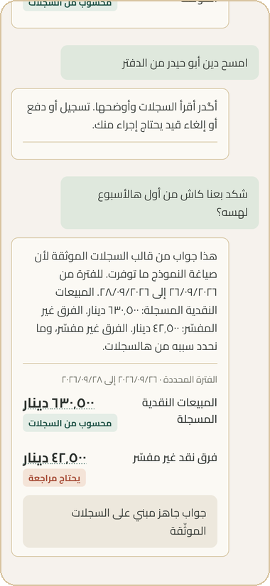
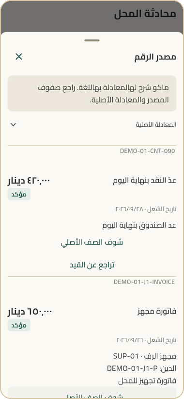
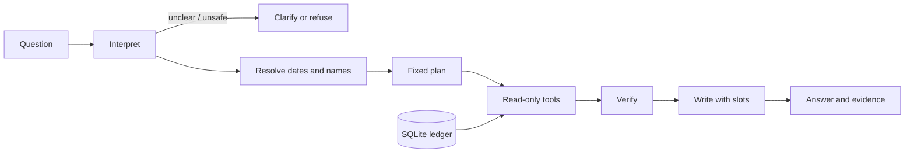
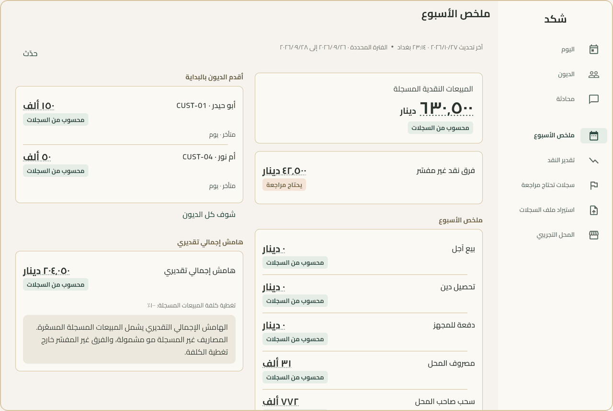
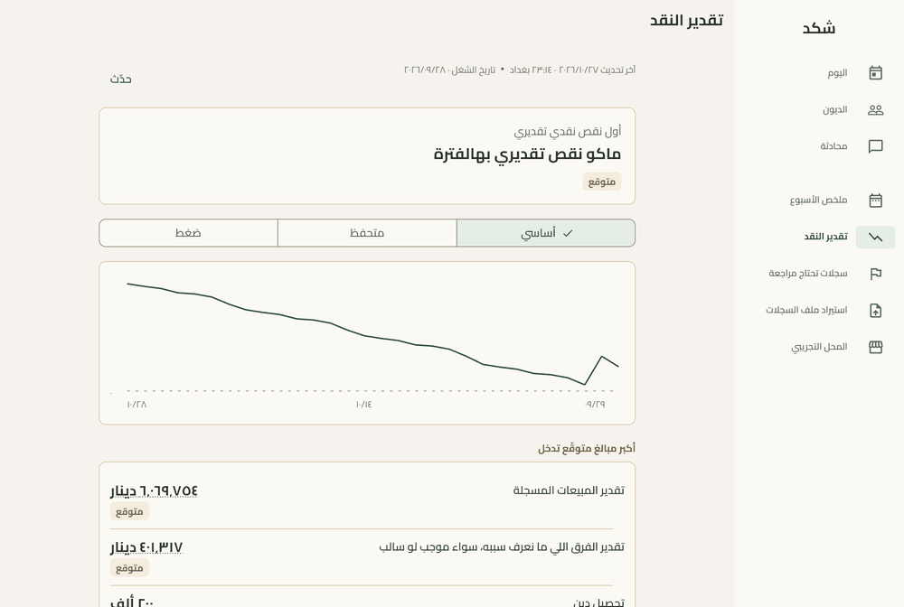

<p align="center">
  
</p>

<h1 align="center">Shgad · شكد</h1>

<p align="center">
  <b>An Iraqi Arabic cash-flow assistant for neighbourhood shops.</b><br>
  Ask your ledger a question. Every number in the answer links back to the record it came from.
</p>

<p align="center">
  
  
  
  
  <br>
  <sub>Agentic AI Challenge Iraq · ZainCash · Topic 02: SME &amp; Merchant Assistant · synthetic data only</sub>
</p>

<table align="center">
  <tr>
    <td align="center" width="25%"><br><sub><b>Today</b><br>cash and the next 7 days</sub></td>
    <td align="center" width="25%"><br><sub><b>Ask</b><br>“can I pay the supplier Thursday?”</sub></td>
    <td align="center" width="25%"><br><sub><b>Stay safe</b><br>refuses edits, flags gaps</sub></td>
    <td align="center" width="25%"><br><sub><b>Verify</b><br>tap a number, see its rows</sub></td>
  </tr>
</table>

<p align="center"><sub>Screenshots from the running app: the fictional sample shop, with live Gemini answers.</sub></p>

## Why

A shopkeeper sells for cash, gives customers credit and pays suppliers on fixed days.
Their real question is short:

> **عندي فلوس تكفي أدفع للمجهز الخميس؟** — *Do I have enough to pay the supplier on Thursday?*

General chatbots answer it confidently and wrongly. They invent figures, count credit
sales as cash, or count a collection as a new sale. For a merchant, a wrong number is
worse than no answer.

## How Shgad stays honest

- **The AI never types a number.** It writes slots like `{{fig:cash_on_hand}}`, and the server fills them from verified tool output.
- **The AI never writes to the ledger.** It can only call five read-only, allowlisted tools.
- **Every figure has a receipt.** Tap a figure to see its formula and source rows, down to the original CSV cells.
- **No guessing.** It asks when a name, date or data is unclear, and refuses requests to change records.

Eleven ways it can fail, what it does instead, and the tests that prove it: [`FAILURE_MODES.md`](FAILURE_MODES.md).

## Results

60 held-out questions that the builders never saw, run **once** on a frozen version of the app.

Measured on `freeze-heldout-v3`; later fixes (this-week and now payment questions,
flag summaries, expense totals, flexible import) are not part of that measurement.

| Run | Answers | Safe handling | Traceable figures | Joint |
|---|:-:|:-:|:-:|:-:|
| v1 | 8/40 | 0/20 | 38/39 | 12/60 |
| v2 | 6/40 | 14/20 | 22/58 | 10/60 |
| **v3 (frozen)** | **39/40** | **20/20** | **170/170** | **56/60** |
| *Target* | *95%* | *95%* | *100%* | *90%* |

Full receipt: [`results/evaluation_heldout_v3_FIRST.md`](results/evaluation_heldout_v3_FIRST.md)

<details>
<summary><b>What changed from v2 to v3</b></summary>

<br>

The low early scores came from the design, not the model:
- clarifications could never pass;
- intent was read from a separate, blind probe;
- routing used regex fitted to 32 questions;
- the label rules were vague.

The v3 agent works in five steps:
1. **Interpret.** The model returns strict JSON, and the server checks each part against the question text.
2. **Resolve.** Code resolves dates and names on the shop's business clock.
3. **Plan.** A fixed plan per intent picks the tools.
4. **Verify.** Read-only tools compute the figures, and a verifier recomputes them.
5. **Fill.** The model writes the answer with slots, and the server fills them in.

It was developed on 200 new reviewed questions: 149/150 on train and 47/49 on check (check reported in aggregate only).

</details>

<details>
<summary><b>How the held-out test was kept independent</b></summary>

<br>

- A separate, memory-off Codex session with no project access wrote the questions. A second session wrote the answer keys. An Iraqi Arabic speaker reviewed both.
- Before the run, these were sealed by SHA-256:
  - the questions (`378b3613…`);
  - the answer keys (`fce35f5e…`);
  - the evaluation method (`87483534…`).
- The app was frozen at tag `freeze-heldout-v3`.
- One run with 101 Gemini requests, all HTTP 200. Only aggregate results were reported, and nothing was tuned on them.
- **Disclosed:**
  - The synthetic ledger had been used during development.
  - The method freeze was redone once, before any v3 question existed.
  - One development check question was seen by accident.
  - The v1-method joint score in the receipt (0/60) is structural: that method needs the probe that v3 no longer runs.

</details>

## Architecture



| | |
|---|---|
| **App** | Flutter web, Arabic RTL, BLoC + Clean Architecture, offline read-only cache |
| **Backend** | FastAPI + SQLite, integer IQD only |
| **Models** | `gemini-3.8-flash` (primary), `gpt-6-luna` (fallback), called from the backend only |
| **Data** | Synthetic: one fictional shop, 90 days, 733 transactions |

Besides chat, the app has:
- debts with partial payments;
- quick entry with undo;
- daily close;
- CSV import (map → preview → confirm);
- mapped Iraqi dates, integer IQD separators/suffixes, and existing counterparty names;
- a review queue for duplicates and unmatched payments;
- a weekly summary;
- a three-scenario cash estimate.

<details>
<summary><b>Weekly summary and cash estimate (desktop)</b></summary>
<br>

<br><br>

</details>

## Run locally

```powershell
python -m venv backend/.venv
backend/.venv/Scripts/python.exe -m pip install -e 'backend[dev]'
copy .env.example .env   # add your own API keys locally

cd backend
$env:BUSINESS_AS_OF = '2026-09-28'; $env:DATABASE_URL = 'sqlite:///./demo.sqlite'
.venv/Scripts/python.exe -c "from app.db.connection import connect_database; from app.db.migrations import apply_migrations; apply_migrations(connect_database('demo.sqlite'))"
.venv/Scripts/python.exe -m uvicorn app.main:app --host 127.0.0.1 --port 8154 --no-access-log
```

In a second terminal:

```powershell
Invoke-RestMethod -Method Post http://127.0.0.1:8154/api/demo/reset   # load the sample shop
cd frontend; flutter pub get --enforce-lockfile
flutter run -d chrome --dart-define=API_BASE_URL=http://127.0.0.1:8154
```

Try asking `منو بعده بذمته فلوس؟` or `شكد بعنا كاش من أول هالأسبوع لهسه؟`.

Latest checks: backend 1,535 passed, 1 skipped; Flutter 369 passed.
Backend lint/format and Flutter format/analysis pass. The 34 strict canonical-import
tests remain unchanged and passing.

## Limits

- **The forecast is weak.** It does worse than a simple seven-day baseline: MAE 978,995 vs 666,064 IQD on the final test. It is a labelled, secondary estimate.
- **Some answers sound robotic.** When the model's wording fails validation, a fixed template with the same verified figures is used instead.
- **Expense kinds are not recorded.** Questions about electricity or rent show the period's total recorded operating expenses with an explicit note. Imports require existing accounts and explicit due dates for credit sales and supplier invoices.
- **No real merchant has used it yet.** It has been tested on synthetic data only.
- **It runs locally only.** There is no authentication or hosting. The Android build is unverified. OCR, voice and WhatsApp are not built.

## Disclosure

- **Models:** Google `gemini-3.8-flash` and OpenAI `gpt-6-luna`. Only synthetic data is sent to them.
- **AI coding assistants:** Claude Code and OpenAI Codex. The evaluation questions and answer keys were written by separate memory-off Codex sessions.
- **Human review:** an Iraqi Arabic speaker reviewed the evaluation questions and answer keys.
