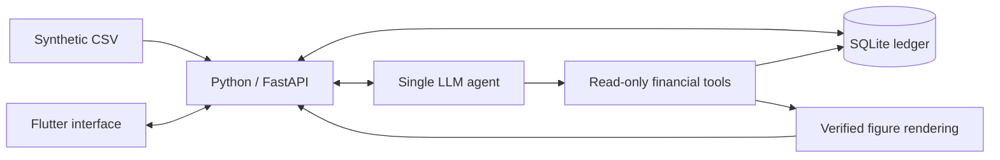

# Shgad (شكد)

An Iraqi Arabic cash-flow assistant for a neighbourhood merchant who tracks cash sales,
customer credit and supplier payments. Shgad aims to turn those records into clear answers
with figures that can be traced back to their source rows.

Built for the Agentic AI Challenge Iraq, Topic 02 (SME & Merchant Assistant).

> **Available now:** a tested backend for synthetic CSV import, merchant entries,
> partial payments, voids/corrections, ledger evidence and daily-close review.
> Source-linked sales/debt queries and a next-days obligations HTTP view separate
> confirmed cash from expected collections, with missing balances kept unavailable.
> Five read-only tools, margin/weekly reports, deterministic Arabic figure rendering,
> reconciliation and cutoff-safe cash-estimate HTTP routes are tested. Chat and CSV
> mapping use a configurable provider client with bounded retries and failover;
> their integration is verified with recorded provider responses.
> Flutter web includes Today, customer/supplier debts, confirmed entries with undo,
> daily-close review, backend-rendered chat, source evidence, weekly reports,
> three-scenario estimates, a fictional sample shop, CSV import and review flags.
> Read-only caches retain update/count times; offline writes are disabled.
> The interface adapts from compact bottom navigation to medium/expanded rails,
> with accessible ledger colors, shared controls and keyboard focus.
> Gemini, Groq and OpenAI completed bounded development routing screens. With
> larger time/token limits, Gemini 3.8 Flash scored 9/10 and GPT-6 Luna 7/10.
> Both selected provider APIs now respond successfully. Live CSV previews and
> controlled fallback checks pass. A five-case application check matched four
> expected tool sets and three full responses; weekly-summary and response-format
> limitations remain.
> The development forecast benchmark performs worse than the seven-day baseline;
> final testing has not run.
> The 55 fixed backend and 277 frontend Arabic messages have human approval.
> The developer manually accepted the current visuals; advisory layout findings remain.
> New or edited wording requires review.

## Capabilities

- Import fictional CSVs into a validated SQLite ledger with replay-safe batch receipts.
- Record debts, partial payments, expenses, drawings, capital and cash counts through HTTP endpoints.
- Keep recorded cash sales separate from signed unexplained cash differences.
- Preserve immutable evidence through merchant voids and explicit corrections.
- Identify unmatched/candidate payments, partial balances, overdue debts and suspected duplicates.
- Query sales, debts, reconciliation, estimated gross margin and cash estimates through five validated tools.
- Return deterministic weekly totals and a secondary cash estimate with base, conservative and stress scenarios.
- Render sourced figures and dates in Arabic, with validation and deterministic template fallback.
- Flutter web opens on today's cash and seven-day obligations, with Arabic/English layouts and Cairo typography.
- Responsive navigation and ledger layouts cover phones, tablets and desktops; controls support keyboard focus and reduced motion.
- Review entries before saving, retain source IDs and undo through immutable void evidence; daily-close values refresh after saves and undos.
- Seed/reset the fictional sample through the interface; pick synthetic CSVs, edit mappings, preview and confirm imports.
- Keep last-synced reports available offline while retaining form input and disabling writes without a queue.
- Answer chat requests through a bounded, read-only agent with verified figures and source evidence.
- Grade historical responses with independent integer-IQD calculations, exact customer/period checks and source-row validation; keep sealed questions separate from development inputs.

## Merchant questions

These examples describe the intended experience:

| Question | Intended answer |
|---|---|
| عندي فلوس تكفي أدفع للمجهز الخميس؟ | Cash available for a supplier payment, separating confirmed cash from expected collections. |
| منو بعده بذمته فلوس؟ | Outstanding customer debts and their due dates. |
| أكو دفعات ما تطابقت؟ | Unmatched payments and possible duplicates, with explanations. |
| شلون كان شغلنا هالأسبوع؟ | A week-to-date summary of sales, collections, spending and estimated gross margin coverage. |
| الشهر الجاي أكدر أوفي التزاماتي؟ | A secondary cash estimate with base, conservative and stress scenarios. |

## Architecture



Financial calculations use integer IQD in Python. The tools and renderer work without
an LLM. The agent requests these tools and drafts explanations with symbolic slots;
the backend fills figures and dates from verified results. Provider calls and API
keys stay in the backend. Integration tests use recorded provider responses.
The selected primary is `gemini-3.8-flash`, with OpenAI `gpt-6-luna` as the
fallback. Paid API access is user-reported. Both APIs have successful live checks;
primary/fallback CSV previews and controlled OpenAI fallback chat passed. The
development results and their limitations are recorded below.

## Development status

The backend requires Python 3.11+ and was verified locally with Python 3.14.7.
From the repository root, create an environment and install the pinned dependencies:

```sh
python -m venv backend/.venv
# Windows PowerShell:
backend/.venv/Scripts/python -m pip install -e 'backend[dev]'
# macOS / Linux: use backend/.venv/bin/python in place of the Windows path.
```

Then, from `backend/`, use that environment's Python:

```sh
python -m pytest -q
python -m ruff check .
python -m ruff format --check .
python -m uvicorn app.main:app --reload
```

Activate the environment first (`.venv/Scripts/Activate.ps1` in PowerShell or
`source .venv/bin/activate` on macOS/Linux). `GET http://127.0.0.1:8000/health`
returns `{"status":"ok","version":"0.1.0"}` without configuration values.
For local development, copy `.env.example` to a repository-root `.env` if it does
not already exist, then edit it locally. The backend loads that exact file from
either the root or `backend/` working directory. Non-empty process environment
variables override file values; blank optional values use defaults. Keep `.env`
out of Git and chat. Set `APP_ENV=test` or `APP_ENV=production` in the launching
process to use environment variables without reading the local file. Restart the
backend after changing configuration.

The setup template selects Gemini 3.8 Flash and the OpenAI fallback. For an existing
local configuration, set these non-secret fields while keeping keys local:

```dotenv
LLM_PROVIDER=gemini
LLM_MODEL_ID=gemini-3.8-flash
LLM_FALLBACK_PROVIDER=openai
LLM_FALLBACK_MODEL_ID=gpt-6-luna
LLM_TIMEOUT_SECONDS=30
LLM_MAX_OUTPUT_TOKENS=8192
```

Selecting the model does not change an existing `.env` file or verify live chat
and CSV mapping. The earlier 9/10 result measures development routing only.
Keep `GEMINI_API_KEY` and `OPENAI_API_KEY` local. The selected setup uses a
30-second request deadline. Paid access still has [rate limits](https://developers.openai.com/api/docs/guides/rate-limits);
the client retains bounded retries and provider failover.
`LLM_MAX_OUTPUT_TOKENS` optionally sets the output bound (256–32,768 tokens).
The selected setup uses 8,192; when unset, compatible requests retain 2,048 and
OpenAI Responses retains 8,192. Explicit truncated or filtered completions are
rejected before use, with the existing failover/template handling.
If the single draft retry returns a valid clarification or refusal, chat uses
that fixed response instead of replacing it with a financial template.
An empty fallback template asks for clarification rather than claiming to have
answered the ledger question.

No `.env` file or provider credentials are needed for health checks. `BUSINESS_AS_OF`
stays unset in raw settings until configured. The domain `BusinessClock.from_settings`
uses the configured date, or **2026-09-28** (synthetic day 90) when absent; it never
uses the server date. Weeks run Saturday–Friday, and naming today's weekday requires
clarification. Baghdad business dates are derived from offset-aware timestamps;
storage uses UTC.

The backend foundation includes strict integer-IQD records, digit/IQD parsing,
and deterministic cash, sales and settlement primitives. Recorded cash sales stay
separate from signed unexplained differences; missing consecutive counts remain
unavailable. Capital injections add cash without sales, revenue or collections.
Drawings remain separate from business expenses.

SQLite schema version 4 has sixteen STRICT tables, with foreign keys, unique
idempotency keys, guarded partial-payment allocations and immutable source evidence.
`POST /api/entries/{source_id}/void` supports merchant undo with client idempotency
and cutoff-aware calculations. Voiding a collection restores outstanding
debt while retaining original transactions, raw rows and linked reason/timestamp audits.
For a correction, void the original and send its ID as `correction_of_source_id`
on the replacement entry. It retains the original event time and an immutable link,
so correcting a pre-count payment does not add cash again. New entries follow the
last known event on their supplied business date. `GET /api/ledger/transactions` supports
date/type/customer/source-ID filters and cursor pagination; its source-ID detail
route returns raw cells, flags and the original amount with any linked void audit.
Versioned migrations preserve earlier ledger/mapping records and roll back atomically. Unknown opening cash
raises a typed error.

Migrations use the standard-library SQLite driver and require SQLite **3.37+**
(STRICT tables); local verification used SQLite 3.50.4. To create an empty schema,
run this Python from `backend/` with its environment activated:

```python
from contextlib import closing
from app.db.connection import connect_database
from app.db.migrations import apply_migrations

with closing(connect_database("shgad.db")) as connection:
    apply_migrations(connection)
```

This creates the schema only. Preload fictional reference and opening records
before importing or recording debts. Demo reset and automatic demo-data loading
remain planned.

`POST /api/entries` records cash/credit sales, supplier invoices, explicit partial
collections/payments, expenses, drawings, capital and daily cash counts. Amounts
are strict positive integer IQD; invalid references and overpayments are rejected
atomically. Retry with the same `client_entry_id` and payload to receive the saved
source ID without another financial effect. A changed payload under that key fails.

The Python service `app.services.ingest.import_csv` imports explicitly fictional
canonical CSV files into a migrated SQLite connection. Preload verified categories,
counterparties and opening records separately. It validates UTF-8/BOM files up to
5 MiB / 10,000 rows, normalizes Arabic-Indic amounts, preserves raw cells and errors,
and commits validated rows and quarantine evidence atomically. Explicit compatible
obligation references and unique strong matches create payment allocations. Strong
matches require the exact party, a sufficient outstanding balance and a due date
within 30 days. Candidate/unmatched payments and suspected
duplicates remain flagged for review. Exact file replay adds no transactions,
cash, revenue, obligations or allocations; receipts distinguish accepted, rejected,
exact-duplicate and flagged rows. `POST /api/imports/csv` accepts a multipart `file`;
`GET /api/imports/{batch_id}` retrieves its receipt and row errors. Files must be
fictional. No reference data is created automatically.
Uploads retain real audit times; late knowledge stays excluded from earlier cutoffs.

Unfamiliar CSV layouts have mapping preview and confirmation endpoints at
`POST /api/imports/csv/mapping` and `POST /api/imports/csv/mapping/{mapping_id}/confirm`.
The proposer interface receives only the header and three sample rows. Code validates
its mapping and previews up to five parsed rows without financial writes. Confirmation
uses saved immutable input/mapping metadata and the normal importer; retries are safe.
The proposer uses the same configurable client as chat. An unconfigured client
returns `LLM_UNAVAILABLE`. Recorded-response integration tests cover the HTTP
proposal, preview and explicit confirmation flow. One live OpenAI fallback preview
produced five parsed rows without errors or ledger writes. After the paid-access
update, both Gemini and OpenAI passed this same bounded preview check.

`app.services.reconcile.reconciliation_report` reads cutoff-bounded SQLite and
returns definite/strong/candidate/unmatched status, reasons, source IDs and current
partial/overdue flags. It creates no links. Similar names and ambiguous obligations
remain candidates for merchant review. Ledger detail includes these flags.

`app.services.forecast.forecast` reads only a cutoff-filtered SQLite snapshot and
returns 30 integer-IQD daily estimates for base, conservative and stress scenarios.
Recorded sales and signed unexplained differences remain separate drivers; conservative
collections use observed settlement lateness, stress collections are zero, and overdue
receivables are excluded. Unknown starting cash, essential history or due dates produce
typed clarification errors. Later entries, payment links and voids cannot change an
earlier forecast. The service enforces the observed calendar boundary and loads no
files or evaluation answers. `GET /api/reports/forecast` exposes the service;
the web workflow shows these secondary estimates; final accuracy testing remains
pending. Observed-data development errors are reported below.

Seeded fictional data and offline development truth are available. From the
repository root (standard library only):

```sh
python scripts/generate_synthetic_data.py --seed 20260701
python scripts/make_ground_truth.py
```

The generator writes 90 observed days and 30 separate future days for one
fictional shop, plus three shops reserved for frozen final forecast testing.
It constructs daily counts, recorded sales, signed unexplained differences,
capital, credit and supplier settlements, and isolated review/void fixtures.
The independent calculator imports no backend financial services. Its
development expectations include sales, debts, estimated gross margin,
seven-day positions and three forecast scenarios at historical cutoffs.
These are offline reference values; the separate production forecast service uses
the financial specification and SQLite history. The five read-only tools query
that ledger without a provider. Development score windows stop at day 90.

With the backend environment installed, the offline benchmark is available from
the repository root:

```sh
python scripts/run_forecast_eval.py --split dev --output results/forecast_dev.json
```

Commit verified source first; the benchmark records its Git commit, source and
input hashes, settings and exact scored-day counts. Both development cutoffs
generate 30 predictions: cutoff 60 grades days 61–90 and cutoff 75 grades only
76–90. It reports integer-IQD MAE against the seven-day baseline, worst-day error,
shortfall timing and false-OK numerator/realized-shortfall denominator/rate per
scenario and for the J1/seven-day with-expected views. A zero denominator has a
null rate. Aggregates weight MAE by scored days and count invoice-cutoff observations.
The baseline rounds `(cutoff count − count seven days earlier) / 7` half up to
whole IQD once, then adds each day's multiple of that change to cutoff cash.
Missing or ambiguous anchor counts give typed errors. Existing result files
are never overwritten.
The final-test path requires a separate explicit run flag and a matching frozen
method/settings/source-commit receipt before opening final outcomes or extra shops.
No final test has run. Conservative collection dates round the exact median
lateness half up once to whole days before adding it to the due date.
**Forecast development results — 20 October 2026.** The actual offline run at
source `1dc2179ab1fe80ba799b11c518f1838fb10a523d` used method
`recorded-weekday-cash-v1` and model ID `deterministic-no-llm`.
All amounts in this table are integer IQD.

| Cutoff day | Scored forecast-days | Baseline MAE | Base MAE | Conservative MAE | Stress MAE |
|---|---:|---:|---:|---:|---:|
| 60 | 30 | 246,560 | 688,086 | 699,245 | 604,901 |
| 75 | 15 | 200,923 | 330,233 | 330,233 | 330,233 |
| Combined | 45 | 231,348 | 568,802 | 576,241 | 513,345 |

Both cutoffs generated all 30 predictions; grading used days 61–90 and 76–90.
The combined MAE weights 45 forecast-day observations across the two cutoffs;
their calendar dates overlap. **All three scenarios performed worse than the
baseline at both cutoffs.** Aggregate worst-day errors were
2,096,402 IQD for base/conservative
and 1,894,402 IQD for stress.

There were no realized shortfalls in the scored windows. For each scenario,
shortfall-timing hits were 0/0 (null/N/A), with two forecasts evaluated and no
predicted shortfall date inside either scored window. The baseline predicted
1 September at cutoff 60 and no shortfall at cutoff 75; neither window had a
realized shortfall to match.

| View | False-OK count | Realized-short invoice denominator | Rate | Eligible invoice-cutoff observations |
|---|---:|---:|---|---:|
| base | 0 | 0 | null / N/A | 2 |
| conservative | 0 | 0 | null / N/A | 2 |
| stress | 0 | 0 | null / N/A | 2 |
| Seven-day with expected | 0 | 0 | null / N/A | 2 |
| J1 with expected | 0 | 0 | null / N/A | 0 |

Each cutoff contributed one eligible invoice to each scenario and the seven-day
view, with no realized-short invoice; J1 had no eligible invoices at either cutoff.
These null rates provide no measured evidence about behavior during actual
shortfalls. The T32 synthetic regression separately checks a positive false-OK case.

The [complete development report](results/forecast_dev_2026-10-20.json) records
per-cutoff errors, dates, counts, source/input hashes and all 30 prediction rows.
The [method freeze](results/forecast_method_freeze.json) predates this run and
pins the same code/settings and observed inputs. Independent calculations match
all six complete prediction series; separate error-sum checks agree.
Only the primary fictional shop's observed data was used. Final outcomes,
the three reserved shops and held-out questions remain unaccessed. No final or
real-world accuracy is established, and no method was tuned after this run.

See [data/README.md](data/README.md) for file boundaries and generation
metadata. Same-seed regeneration was byte-identical in a fresh process,
including the manifest. The development questions and generation mechanics have
recorded human review, including all twelve note phrases and four scenarios.
The historical test set has 60 human-reviewed questions and a
[hash/count manifest](data/evaluation/heldout_60_manifest.json); the questions
remain outside the repository. Generation used a separate session of the same
tool used during development. Memory controls were requested; isolation was not
independently verified and the exact generator model ID was not exposed.
No held-out model evaluation has run.

`scripts/model_smoke_test.py` prepares a provider comparison using ten fixed,
reviewed development questions and the existing five read-only tool schemas.
With the backend development environment installed, run from the repository root:

```sh
python scripts/model_smoke_test.py
python scripts/model_smoke_test.py --help
```

The default is a dry run with no provider requests. Live use requires `--live`,
exact provider model IDs through `--gemini-model` and `--groq-model`, their
`--model-ids-checked-on` date, and the selected provider keys in local `.env` or
process environment variables. `--provider gemini` or `--provider groq` runs one
candidate and requires only its key; the default compares Gemini and Groq.
An explicit `--provider openai --openai-model gpt-6-luna` comparison uses a local
`OPENAI_API_KEY`. This comparison-only path uses Responses with medium reasoning,
no temperature override and optional response storage disabled. It preserves the
same logical prompts, tool parameter schemas and scoring. API/reasoning differences
limit comparisons with the compatible-chat providers. The application also supports
OpenAI as the configured fallback; these comparison results do not measure fallback
behavior.
Only an explicit live run loads credentials; the default
dry run leaves `.env` untouched. Never paste keys into chat. It compares interpretation
and native tool selection against development labels, including customer and period.
It executes no proposed tools and measures no financial-answer accuracy. The hard
cap is 40 requests, with no retries and at least ten seconds between a provider's
requests. Provider errors stop that candidate. The default HTTP timeout is 20s
and output limit is 768 tokens; explicit `--timeout-seconds` (1–300) and
`--max-tokens` (1–32,768) support slower reasoning models. Reports record these
limits, known finish reasons and available token-usage counters, without retaining
model prose or tool arguments. Per-request elapsed times include pacing waits.
Scores from different limit settings are not controlled model comparisons.
Full application quality remains unverified.

`--minimum-interval-seconds` selects 10-60 seconds between a provider's requests
(default 10); `--progress` prints aggregate case/request counts to stderr.
For `qwen/qwen3.8-27b` on Groq, the comparator defaults to medium reasoning;
`--qwen-reasoning-effort none|low|medium|high` selects an explicit profile.
Hidden reasoning format, temperature 1 and top_p 0.95 preserve the same prompts
and tool parameter schemas. Its documented output cap of 16,384 tokens is checked
before loading credentials or sending requests. Model-specific overrides and
actual pacing are recorded in the report; this profile does not change the app.
Quota failures retain only recognized error codes and bounded numeric limit,
remaining-token, requested-token and retry/reset counters. Provider messages,
organization names and secret values are not retained.
Distinct quota counters from headers and provider messages are preserved separately,
along with an allowlisted metric label when the provider identifies one unambiguously.

NVIDIA-hosted candidates are available explicitly through `--provider nvidia
--nvidia-model ...`, using the optional local `BUILD_NVIDIA_API_KEY`. Supported
comparison IDs are `z-ai/glm-5.3`, `moonshotai/kimi-k3`,
`stepfun-ai/step-5-preview` and `z-ai/glm-5.3-flash`. GLM and Kimi profiles request
Max reasoning; Step keeps native reasoning enabled. Reports record their sampling
and chat-template options. Optional `--nvidia-stream` assembles native SSE content
and function-call fragments, discards separate reasoning, and rejects incomplete
or truncated responses. NVIDIA comparisons allow up to 900s HTTP timeouts;
other providers retain the 300s ceiling. Streams bound decoded bytes and retained
output, including unterminated lines, with no automatic retries. The default comparison remains Gemini/Groq;
the application uses the separately configured Gemini/OpenAI roles above. NVIDIA model access and quality
must be measured separately; a catalog listing alone is not an inference result.

On 19 October, NVIDIA screens used the same ten development questions,
logical prompts, five schemas and scorer. Complete Flash/Step runs used clean
source `b72908f`; the later partial GLM streaming run used clean `019de2b`:

| Candidate | Jointly correct | Correct native tool set |
|---|---|---|
| `z-ai/glm-5.3-flash` (Max) | 6/10 | 10/10 |
| `stepfun-ai/step-5-preview` | 0/10 | 10/10 |
| `z-ai/glm-5.3` (Max) | Partial: 1 passed, 9 unscored | 1/1 completed |
| `moonshotai/kimi-k3` (Max) | Unscored: HTTP 410 | Unscored |

Flash and Step each completed 20 requests without provider errors, retries or
reported truncation, with 32,768-token output limits, 300s HTTP timeouts and 30s pacing.
Flash reported 37,479 total tokens; Step reported 41,622. Step failed every
separate interpretation check while passing every native tool/context check.
One additional unscored format probe returned separate reasoning without final
text; it does not establish the cause of every original failure or change scores.
These are strict routing/format screens, not application or Arabic-language
quality scores. Their reasoning and resource profiles differ from earlier runs.

`moonshotai/kimi-k3` returned HTTP 410 on its first attempt; NVIDIA's
[deployment page](https://build.nvidia.com/moonshotai/kimi-k3?section=deploy)
marks its free endpoint deprecated. All ten cases remain unscored.
GLM's initial nonstreaming runs produced two unpaired interpretations, one
300s timeout and one HTTP 504 despite a 900s client timeout. A separate unscored
streaming probe returned a well-formed native call after 405s. The fresh fixed
streaming screen then completed and passed one question before another upstream
HTTP 504 stopped the second question: four attempts, three responses and nine
unscored questions. Its successful responses reported 4,930 total tokens.
There is insufficient data for a ten-question GLM score; no further retry ran.

Across these NVIDIA checks, **51 generation attempts** used the original
80-attempt budget: 47 decoded responses and four failures, plus one catalog GET.
Known reported usage totals **91,287 tokens**; failed-request usage is unknown.
Failures and unpaired answers are retained without adding scored questions.

Measured locally on 18 October 2026 at source commit `ca62b01`: both candidates
completed the ten-question development screen using 40 requests total, with no
provider errors or retries. Joint correctness requires intent, behavior, tool
choice, customer and period to agree with the development labels.

| Candidate | Jointly correct | Correct tool set |
|---|---|---|
| `gemini-3.1-flash-lite` | 6/10 | 9/10 |
| `openai/gpt-oss-120b` on Groq | 4/10 | 5/10 |

This first comparison requested temperature 0, a 768-token output limit and a
20s HTTP timeout. This small development screen uses a separate routing
prompt; it does not measure application answers, financial accuracy or held-out
performance. Development tuning and human acceptance remain pending.

An additional check on 18 October at clean source `54a7382` used the same ten
questions, prompts, gold labels and tool schemas with `gemini-3.8-flash`:
**9/10 jointly correct and 9/10 correct tool sets**, with intent, behavior,
customer and period each correct on all ten. All 20 requests completed with no
provider errors, retries or reported truncation. This run allowed 180s per HTTP
request and 32,768 output tokens, with at least ten seconds between requests.
The API reported 34,829 total tokens across the run. Its larger time/token limits
differ from the first comparison, so the score difference cannot be attributed
solely to model choice. Gemini 3.8 Flash was subsequently selected as primary;
live application answer quality remains pending.

A further check on 18 October at clean source `937d180` used `gpt-6-luna`:
**7/10 jointly correct and 9/10 correct tool sets**, with all 20 requests
completed and no provider errors, retries or truncation. This screen used the
same ten questions, logical prompts, tool parameter schemas and scorer, with
180s HTTP timeouts and 32,768 output tokens. Luna used Responses with medium
reasoning, no temperature override and optional response storage disabled.
The API reported **23,919 total tokens**, including **2,095 reasoning tokens**.
The failed checks concerned one interpreted period, the reconciliation tool set
for conflicting records, and one unsupported-write interpretation. These are
single development screens with different API/reasoning profiles, not controlled
model rankings or live application/financial-answer accuracy.

The `qwen/qwen3.8-27b` screen on Groq completed on 19 October at clean source
`7da09ec` with a recorded local operational adapter: **2/10 jointly correct,
8/10 correct tool sets and 9/10 valid tool selections**. All 20 requests completed
without provider errors, retries or reported truncation, using 29,937 reported
tokens. The profile used **reasoning none**, hidden format, temperature 1/top_p
0.95, 768 output tokens, 180s HTTP timeouts and at least 65s actual spacing
(60s CLI setting). No separate reasoning-token counters were reported.

Sanitized provider metadata identified a separate 1,000 output-token-per-minute
limit alongside the 8,000 combined-token limit. Earlier setup/diagnostics are
retained separately: 12 attempts, six successful responses, five HTTP 429
rejections and one HTTP 400; interrupted answers are not extra scored questions.
The complete Qwen check therefore used 32 generation attempts within its 40-attempt
recovery cap. Logical prompts, development questions, schemas and scoring stayed
unchanged. Different reasoning/resource profiles prevent a controlled model
ranking; Gemini 3.8 Flash is the selected primary and live answer quality remains pending.

The Flutter web app uses Arabic RTL by default, supports English labels, and bundles
Cairo with its license. Today, debts, confirmed entries/undo, daily close, source
evidence, backend-rendered chat, weekly reports and secondary cash estimates use
the verified backend APIs through one Dio client. Chat replies remain server-rendered
Arabic. Read-only screens cache responses with update times; offline writes are
disabled and typed form values stay in place. No write queue or frontend provider key.
The local SDK is Flutter3.44.9 stable/Dart3.12.2.

From `frontend/`:

```sh
flutter pub get --enforce-lockfile
flutter gen-l10n
dart format --output=none --set-exit-if-changed lib test
flutter analyze
flutter test
flutter run -d chrome --dart-define=API_BASE_URL=http://127.0.0.1:8000
```

To build the web app with runtime assets served locally:

```sh
flutter build web --release --no-web-resources-cdn --dart-define=API_BASE_URL=http://127.0.0.1:8000
```

The Android target is scaffolded as `com.aw.shgad`, display name «شكد»; Android builds
and release signing have not been verified. Arabic copy is awaiting Iraqi Arabic review.
Open **More → Sample shop** to restore the clearly fictional observed shop, then
open Today and Chat. Reset asks before replacing sample edits and clears old caches
and chat. It is disabled in production. The web CSV picker supports manual column
mapping, a server-validated preview of up to five rows and explicit confirmation;
edits require a fresh immutable preview. All files must be synthetic. The complete
HTTP interfaces are documented at `/docs`.
`GET /api/daily-close/{date}` compares consecutive counts against recorded cash
flows and shows the signed unexplained difference. Missing counts remain missing.
`POST /api/daily-close/{date}/resolve` accepts a merchant-chosen explanation or
`leave_unexplained`. Sign/amount guards and client idempotency prevent a second
financial effect; a voided explanation stays in review history. No cause is inferred.
`GET /api/obligations/upcoming?days=7` lists supplier dues, non-overdue expected
collections and separate overdue receivables. It returns signed confirmed-only
and with-expected positions, daily running balances and first negative dates,
without projected sales. The window accepts 1–30 days; missing cash retains known
obligations with unavailable positions. `GET /api/debts` provides receivable totals,
aging and exact-party evidence. The read-only sales/debts tool wrappers validate
arguments and resolve symbolic periods on the server. `GET /api/reports/margin`
returns estimated gross margin, recorded-sales coverage, unpriced-sale count,
buy-price evidence and an after-recorded-expenses figure with excluded-cost notes.
`GET /api/reports/weekly` returns deterministic weekly totals and shows estimated
margin only at the configured coverage threshold (80% by default;
`MARGIN_MIN_COVERAGE_PCT`). Voided sales and expenses are excluded using the query's
audit knowledge. All five tools validate arguments and verify source references,
integer units and arithmetic before a protected renderer handoff.
`GET /api/flags` exposes reconciliation flags; `GET /api/reports/forecast`
exposes the existing cutoff-safe scenarios. `/api/meta` reports whether a provider,
model ID and local key are configured; this does not probe network availability.
The weekly report includes the actual warning items with amounts, source IDs,
reasons, matching logic and safe review steps. Duplicate-only and overdue-supplier
warnings suggest review. Recorded cash sales, signed unexplained differences, credit sales,
collections, expenses, drawings and capital stay separate. Debt aging is oldest
first; insufficient price coverage hides the estimated margin and retains coverage.

`POST /api/chat` accepts `message` and a correlation `conversation_id`. Each request
starts a fresh tool context. The agent can use only the existing five read-only
tools, with validated arguments, at most four completion turns and eight tool
calls. Responses include the resolved customer and period, sourced figures and
dates, verification evidence and renderer status. Missing balances and ambiguous
names or periods produce fixed clarification messages. Provider failure after a
verified result can return the deterministic template with a fallback notice.

Configure `LLM_PROVIDER` (`gemini`, `groq` or `openai`), `LLM_MODEL_ID` and that provider's
API key in the root `.env` or process environment. `.env.example` lists optional
fallback and timeout settings. `GEMINI_API_KEY`, `GROQ_API_KEY` and `OPENAI_API_KEY` authenticate
provider access; model IDs select models separately. Use exact console model IDs;
keep keys local and never paste them into chat. Without configuration, chat
returns the typed `llm_unavailable` response without a provider request.
The same client uses compatible Chat Completions for Gemini/Groq and Responses
for OpenAI. Luna requests use medium reasoning, an 8,192-token output bound,
no temperature override and `store: false`. Encrypted continuation state stays
in request memory. The five tool parameter schemas and server validation are
shared. Each provider gets at most two attempts per completion; long
`Retry-After` waits defer to fallback instead of retrying early.

`app.agents.renderer` fills `{{fig:key}}` and `{{date:key}}` only from verified
tool output. Raw numeric characters, unknown keys and unsourced values are rejected.
It supports one retry callback and then deterministic templates, with server-resolved
customer/period context, margin coverage and estimate assumptions. Exact user-typed
quotes stay quoted data. Money uses Arabic-Indic digits and exact abbreviations;
evidence retains full integers. The original 50 fixed backend Arabic messages were
approved by the user on 19 October 2026; five weekly suggestion/insufficient-margin
messages were approved on 20 October. Separate per-key hashes bind the exact texts
and their approval dates. Any new or edited copy still needs Iraqi Arabic review.
The agent retries an invalid draft once before using these templates. Imported
text remains quoted data and gives the agent no ledger-write capability.

On 19 October, an opt-in application check at source `a3dd418` used five reviewed
development questions and a temporary observed synthetic ledger. Gemini returned
HTTP 503 on all ten attempts; its five cases remain unscored. Automatic failover
to `gpt-6-luna` produced four grounded answers and one clarification. Three of
five cases matched the expected tools, customer and period. The weekly summary
selected two of four expected tools, and the duplicate-record question clarified
without calling `reconcile`. These are limits of this development check, not
held-out accuracy or a replacement for the earlier routing-screen scores.

A separate OpenAI fallback CSV check passed with one request, five preview rows,
no parsing errors and no financial writes. Across both checks there were
21 actual requests: ten Gemini failures and eleven OpenAI responses, within
the documented 22-attempt combined ceiling. Those original reports remain
unchanged; later development work is recorded below. No held-out run took place.

After the user reported paid access was active, a fresh check at `abaed05` used
15 of its 20 allowed requests: twelve Gemini and three OpenAI responses, all HTTP
200. Both CSV previews and controlled OpenAI fallback passed. Gemini matched
three of five expected tool/customer/period cases; the weekly-summary and
duplicate-record tool-set misses remained. Two answers used deterministic
templates. These are development application results, with no held-out run.

The versioned agent policy now clarifies that possible duplicate-payment
comparisons inspect read-only reconciliation flags before asking for record
identities. It still cannot combine entries or resolve flags. A frozen application
check at `d67667d` matched four of five expected native tool sets: sales, debt,
margin and reconciliation. Three cases also matched behavior, customer and period.
The weekly summary omitted debts/reconciliation. The duplicate-payment case read
reconciliation flags but fell back to an empty answer instead of clarification.
This pass used all 16 allowed requests: thirteen Gemini responses, two Gemini
timeouts and one OpenAI response. The primary CSV preview passed.

A separate duplicate-case diagnostic at `f84f2ee` used three Gemini responses;
both final drafts failed the strict response schema. A local check-script fixture
lookup then failed before its fallback checks. These failures remain recorded.
General fixes now preserve valid clarification/refusal actions on draft retry
and make empty templates ask for clarification. Four regression cases first
failed, then passed. The primary application score was not rerun after these fixes.
The remaining controlled fallback chat and CSV check at `b33618e` passed with
three actual OpenAI responses: correct tool/customer/period/source evidence,
five CSV preview rows, zero errors and no financial writes. That diagnostic and
continuation used six of their combined eight allowed requests.

The paid retry and subsequent development/integration work used 41 of 48
documented generation attempts: 38 decoded successful responses and three failed
requests, with 119,722 known reported tokens. Failed-request usage is unknown.
These small development checks do not establish held-out or general financial
answer accuracy. Original reports and earlier routing-screen scores are preserved.
The first paid retry also recorded two Gemini drafts ending at the old output
cap. The output budget is now configurable; the selected setup uses 8,192 while
retaining its request deadline and response-size bounds.

Verified locally: **730 backend tests passed, one opt-in live test skipped**,
including real HTTP/SQLite financial, mapping, reconciliation, immutable-correction
and cutoff regressions, recorded provider integration, and offline synthetic-data
and model-comparison harness checks. Ruff lint/format and Python 3.11 grammar
checks pass for **131 backend/script files**; dependency checks pass.
An earlier running-server smoke passed **20 check groups across 19 OpenAPI paths**,
using a temporary fictional database. Browser checks also cover sample reset,
bulk evidence, editable CSV previews and merchant entry/void requests.
Every implemented endpoint has a response-model contract test, including daily close,
voids and standard error responses. Financial-rule
regressions were observed failing before their implementation or fix.
To include offline scripts in lint/format checks from backend/, run
`python -m ruff check --config pyproject.toml . ../scripts` and
`python -m ruff format --check --config pyproject.toml . ../scripts`.
Checks include recorded sales and signed differences, capital, review validation,
void-adjusted balances and knowledge cutoffs, v1 upgrades, replay and atomic rollback.
Concurrent review requests cannot explain the same cash twice. The live routing
screen above does not validate complete chat/mapping answers or failover behavior.

The default suite makes no live provider requests. A single development routing
probe requires both `SHGAD_RUN_LIVE=1` and `python -m pytest -m live`; it has a
four-request transport cap. The separate development comparison above retains
its forty-request cap. Neither check accesses held-out questions.

Flutter verification: **176 tests passed**, including BLoC/repository checks,
96 screen cases across Arabic/English, 320/360 px and 1.0/1.3 text scales,
confirmation/undo, source evidence and T33 cache/input retention. Localization,
formatting, analysis and a release web build pass. The SDK integration flow also
passes in Chrome with recorded API responses. Actual release screenshots for
every screen were inspected in Arabic RTL at 360×800 and both text scales.
A separate browser run used real HTTP/SQLite/tools/rendering with a fake provider
transport for sample → J1 chat → evidence → three scenarios → reset. Native CSV
selection/preview/import and offline/write checks use only fictional data.
These checks establish application behavior, not live-model answer quality or
merchant usability. Android, iOS and an independent human usability test have not
been verified. Browser IQD values outside the exact integer range are rejected;
figures and financial calculations stay in the backend.

[GitHub Actions](https://github.com/abdulwahed-s/Shgad/actions/workflows/test.yml)
runs backend lint/format/tests and Flutter localization, formatting, analysis and tests
on pushes and pull requests. Its linked run history shows the measured CI results.
The development forecast benchmark above has run. No final forecast test or
held-out model evaluation has run.

Synthetic CSV generation, ledger import, financial tools, deterministic reports
and the merchant Flutter web workflow are available. Current frontend Arabic
wording is reviewed; merchant usability validation remains pending. The forecast
results above cover one fictional development shop and do not meet the baseline comparison target.
The separate model-routing/application checks retain their reported limitations;
no held-out or general financial-answer accuracy is established.

## Reproducible evaluation

The historical harness separates development and sealed runs. Its default command
prints a plan without loading credentials or opening sealed questions:

```sh
python scripts/run_evaluation.py --split dev --mode plan
python scripts/run_evaluation.py --split dev --mode replay --output results/evaluation_replay.json
python scripts/run_evaluation.py --split dev --mode forecast --forecast-split dev --output results/evaluation_forecast_dev.json
```

The checked-in freeze binds evaluator sources, observed input hashes, prompts,
tool schemas and settings. Reports use actual UTC execution times and code commits,
keep exact counts and preserve existing receipts. Forecast reporting adds separate
prediction and realized CSVs; cutoff75 realized rows stop at day90.

The [four-case synthetic replay](results/evaluation_replay_2026-10-23.md), executed
23 October at source `15abb817`, checks3/3 numeric answers,1/1 clarification,
4/4 joint selections and7/7 evidenced claims using12 fabricated completions and
zero provider requests. It is a protocol test, not a model-quality measurement.
Its initial raw-export reconciliation setup reported precision2/4 and recall2/2.
The [post-run setup receipt](results/evaluation_replay_context_2026-10-23.md)
imports the export's missing parent ledger through the real importer, with labels
unchanged: duplicateTP1/FP0/FN0 and unmatchedTP1/FP0/FN0. These two tiny fixture
cases establish setup correctness, not general reconciliation quality. Original
reports and freezes remain available; later scorer changes are disclosed.
The [latest synthetic receipt](results/evaluation_replay_sealed_requirements_2026-10-23.md)
retains those counts after documented alias, portable-hash and client-routing
corrections. It reproduces from an isolated checkout with no credentials, future
outcomes or unseen shops present. All 835 offline backend tests pass; the live
test is deselected. Lint, formatting and dependency checks also pass. These
checks establish infrastructure behavior; live Q&A remains blocked below. Replay
uses explicit synthetic-fixture requirements and does not replace independent
annotations for live measurements.
The [development forecast receipt](results/evaluation_forecast_dev_2026-10-23.md)
reproduces the earlier below-baseline results with240 prediction and45 realized
rows, and no realized outcome after28 September. Zero realized-shortfall
denominators still give null timing/safety rates.

**Live Q&A awaits independently supplied requirement annotations.** The approved
policy uses separately sealed figure selectors to distinguish total-only,
cash/credit-breakdown and debt-list requests. Original question bytes and seals
stay unchanged. The [selector contract](data/evaluation/REQUIREMENTS_SPEC.md)
defines the exact fields, ordering, review/provenance and hash bindings. Builders
have authored only the contract and fabricated format tests. Missing annotations
block live evaluation before credentials; authorization flags cannot bypass it.
All selectors and independent reference calculations are preflighted before calls
and stay outside the model's context. Independent numeric calculations,
context/evidence checks, exact aliases and synthetic replay remain tested.

After independent annotations are supplied and frozen, live runs require explicit paid-call authorization,
a matching freeze and bounded actual requests:96 development or180 sealed,
at most6 per question including
retries/fallback, at least10 seconds apart,30-second deadlines and8192 output
tokens. A separate blind probe records intent; tool/customer/period are taken from
the production response. All four must match jointly. Every required figure,
unit/category and customer/period must match for whole-question numeric credit.
Unsupported historical evidence shapes fail closed. Safe handling and source-row
coverage are separate metrics. Sealed access uses only `HELDOUT_PATH`, verifies
its committed SHA-256 before parsing and requires separate authorization. Its
JSON/Markdown/stdout remain aggregate-only. Paid evaluation, sealed evaluation and
the frozen final/unseen forecast test have not run.

## Data and scope

All datasets must be fictional. Real customer and transaction records are outside the scope
of this project. The demo will cover one merchant; payment execution and formal tax/accounting
services are outside the planned MVP.

GPT-6.1 Sol drafted the fictional scenario templates. Deterministic seeded Python
generated all numeric records.
The scenario manifest records the drafting brief and the user-confirmed model
display name; the exact provider model ID/settings remain unavailable and are
not guessed. No model-provider API call was used for this dataset.
Application integration is tested with recorded responses. Live development
screening used the candidates above; Gemini 3.8 Flash is the selected primary.
Both selected APIs now respond and both CSV previews pass. Primary-model routing
acceptance remains pending. The 55 fixed backend Arabic messages
have user approval. All 277 frontend messages are also reviewed: the original
248-message review is preserved, and the 29 additions have a separate approval
with 15 Iraqi revisions and 14 retained texts, bound to exact text hashes.
Future additions and edits need a new review.
