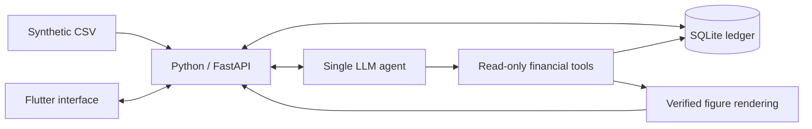

# Shgad (شكد)

An Iraqi Arabic cash-flow assistant for a neighbourhood merchant who tracks cash sales,
customer credit and supplier payments. Shgad aims to turn those records into clear answers
with figures that can be traced back to their source rows.

Built for the Agentic AI Challenge Iraq, Topic 02 (SME & Merchant Assistant).

> **Available now:** a tested backend for synthetic CSV import, merchant entries,
> partial payments, voids/corrections, ledger evidence and daily-close review.
> Source-linked sales/debt queries and a next-days obligations HTTP view separate
> confirmed cash from expected collections, with missing balances kept unavailable.
> Five read-only tools, margin/weekly reports, deterministic Arabic figure rendering,
> reconciliation and cutoff-safe cash-estimate HTTP routes are tested. Persisted
> mapping preview/confirmation works with fake proposals. Flutter remains a static localized
> shell; chat, merchant screens and a live mapping proposer remain planned.
> An opt-in development model comparison has an offline-tested harness; no model
> benchmarks have run.

## Capabilities and planned interface

- Import fictional CSVs into a validated SQLite ledger with replay-safe batch receipts.
- Record debts, partial payments, expenses, drawings, capital and cash counts through HTTP endpoints.
- Keep recorded cash sales separate from signed unexplained cash differences.
- Preserve immutable evidence through merchant voids and explicit corrections.
- Identify unmatched/candidate payments, partial balances, overdue debts and suspected duplicates.
- Query sales, debts, reconciliation, estimated gross margin and cash estimates through five validated tools.
- Return deterministic weekly totals and a secondary cash estimate with base, conservative and stress scenarios.
- Render sourced figures and dates in Arabic, with validation and deterministic template fallback.
- Planned merchant screens will put today's cash, debts, entry and daily close first.
- Planned Iraqi Arabic chat and merchant screens will use verified figures and source evidence.

## Merchant questions

These examples describe the intended experience:

| Question | Intended answer |
|---|---|
| عندي فلوس تكفي أدفع للمجهز الخميس؟ | Cash available for a supplier payment, separating confirmed cash from expected collections. |
| منو بعده بذمته فلوس؟ | Outstanding customer debts and their due dates. |
| أكو دفعات ما تطابقت؟ | Unmatched payments and possible duplicates, with explanations. |
| شلون كان شغلنا هالأسبوع؟ | A week-to-date summary of sales, collections, spending and estimated gross margin coverage. |
| الشهر الجاي أكدر أوفي التزاماتي؟ | A secondary cash estimate with base, conservative and stress scenarios. |

## Planned architecture



Financial calculations use integer IQD in Python. The tools and renderer work without
an LLM. The planned agent will request these tools and draft explanations with symbolic
slots; the backend fills figures and dates from verified results. Provider calls and
API keys will stay in the backend.

## Development status

The backend requires Python 3.11+ and was verified locally with Python 3.14.7.
From the repository root, create an environment and install the pinned dependencies:

```sh
python -m venv backend/.venv
# Windows PowerShell:
backend/.venv/Scripts/python -m pip install -e 'backend[dev]'
# macOS / Linux: use backend/.venv/bin/python in place of the Windows path.
```

Then, from `backend/`, use that environment's Python:

```sh
python -m pytest -q
python -m ruff check .
python -m ruff format --check .
python -m uvicorn app.main:app --reload
```

Activate the environment first (`.venv/Scripts/Activate.ps1` in PowerShell or
`source .venv/bin/activate` on macOS/Linux). `GET http://127.0.0.1:8000/health`
returns `{"status":"ok","version":"0.1.0"}` without configuration values.
Settings read process environment variables; `.env.example` lists the names.
No `.env` file or provider credentials are needed for health checks. `BUSINESS_AS_OF`
stays unset in raw settings until configured. The domain `BusinessClock.from_settings`
uses the configured date, or **2026-09-28** (synthetic day 90) when absent; it never
uses the server date. Weeks run Saturday–Friday, and naming today's weekday requires
clarification. Baghdad business dates are derived from offset-aware timestamps;
storage uses UTC.

The backend foundation includes strict integer-IQD records, digit/IQD parsing,
and deterministic cash, sales and settlement primitives. Recorded cash sales stay
separate from signed unexplained differences; missing consecutive counts remain
unavailable. Capital injections add cash without sales, revenue or collections.
Drawings remain separate from business expenses.

SQLite schema version 4 has sixteen STRICT tables, with foreign keys, unique
idempotency keys, guarded partial-payment allocations and immutable source evidence.
`POST /api/entries/{source_id}/void` supports merchant undo with client idempotency
and cutoff-aware calculations. Voiding a collection restores outstanding
debt while retaining original transactions, raw rows and linked reason/timestamp audits.
For a correction, void the original and send its ID as `correction_of_source_id`
on the replacement entry. It retains the original event time and an immutable link,
so correcting a pre-count payment does not add cash again. New entries follow the
last known event on their supplied business date. `GET /api/ledger/transactions` supports
date/type/customer/source-ID filters and cursor pagination; its source-ID detail
route returns raw cells, flags and the original amount with any linked void audit.
Versioned migrations preserve earlier ledger/mapping records and roll back atomically. Unknown opening cash
raises a typed error.

Migrations use the standard-library SQLite driver and require SQLite **3.37+**
(STRICT tables); local verification used SQLite 3.50.4. To create an empty schema,
run this Python from `backend/` with its environment activated:

```python
from contextlib import closing
from app.db.connection import connect_database
from app.db.migrations import apply_migrations

with closing(connect_database("shgad.db")) as connection:
    apply_migrations(connection)
```

This creates the schema only. Preload fictional reference and opening records
before importing or recording debts. Chat, demo reset and automatic demo-data
loading remain planned.

`POST /api/entries` records cash/credit sales, supplier invoices, explicit partial
collections/payments, expenses, drawings, capital and daily cash counts. Amounts
are strict positive integer IQD; invalid references and overpayments are rejected
atomically. Retry with the same `client_entry_id` and payload to receive the saved
source ID without another financial effect. A changed payload under that key fails.

The Python service `app.services.ingest.import_csv` imports explicitly fictional
canonical CSV files into a migrated SQLite connection. Preload verified categories,
counterparties and opening records separately. It validates UTF-8/BOM files up to
5 MiB / 10,000 rows, normalizes Arabic-Indic amounts, preserves raw cells and errors,
and commits validated rows and quarantine evidence atomically. Explicit compatible
obligation references and unique strong matches create payment allocations. Strong
matches require the exact party, a sufficient outstanding balance and a due date
within 30 days. Candidate/unmatched payments and suspected
duplicates remain flagged for review. Exact file replay adds no transactions,
cash, revenue, obligations or allocations; receipts distinguish accepted, rejected,
exact-duplicate and flagged rows. `POST /api/imports/csv` accepts a multipart `file`;
`GET /api/imports/{batch_id}` retrieves its receipt and row errors. Files must be
fictional. No reference data is created automatically.
Uploads retain real audit times; late knowledge stays excluded from earlier cutoffs.

Unfamiliar CSV layouts have mapping preview and confirmation endpoints at
`POST /api/imports/csv/mapping` and `POST /api/imports/csv/mapping/{mapping_id}/confirm`.
The proposer interface receives only the header and three sample rows. Code validates
its mapping and previews up to five parsed rows without financial writes. Confirmation
uses saved immutable input/mapping metadata and the normal importer; retries are safe.
The default proposer returns `LLM_UNAVAILABLE` because no model is connected yet.
Tests inject fake proposals; there is no live mapping suggestion feature.

`app.services.reconcile.reconciliation_report` reads cutoff-bounded SQLite and
returns definite/strong/candidate/unmatched status, reasons, source IDs and current
partial/overdue flags. It creates no links. Similar names and ambiguous obligations
remain candidates for merchant review. Ledger detail includes these flags.

`app.services.forecast.forecast` reads only a cutoff-filtered SQLite snapshot and
returns 30 integer-IQD daily estimates for base, conservative and stress scenarios.
Recorded sales and signed unexplained differences remain separate drivers; conservative
collections use observed settlement lateness, stress collections are zero, and overdue
receivables are excluded. Unknown starting cash, essential history or due dates produce
typed clarification errors. Later entries, payment links and voids cannot change an
earlier forecast. The service enforces the observed calendar boundary and loads no
files or evaluation answers. `GET /api/reports/forecast` exposes the service;
forecast UI integration and accuracy evaluation remain pending.

Seeded fictional data and offline development truth are available. From the
repository root (standard library only):

```sh
python scripts/generate_synthetic_data.py --seed 20260701
python scripts/make_ground_truth.py
```

The generator writes 90 observed days and 30 separate future days for one
fictional shop, plus three shops reserved for frozen final forecast testing.
It constructs daily counts, recorded sales, signed unexplained differences,
capital, credit and supplier settlements, and isolated review/void fixtures.
The independent calculator imports no backend financial services. Its
development expectations include sales, debts, estimated gross margin,
seven-day positions and three forecast scenarios at historical cutoffs.
These are offline reference values; the separate production forecast service uses
the financial specification and SQLite history. The five read-only tools query
that ledger without a provider. Development score windows stop at day 90.

See [data/README.md](data/README.md) for file boundaries and generation
metadata. Same-seed regeneration was byte-identical in a fresh process,
including the manifest. The development questions and generation mechanics have
recorded human review, including all twelve note phrases and four scenarios.
The historical test set has 60 human-reviewed questions and a
[hash/count manifest](data/evaluation/heldout_60_manifest.json); the questions
remain outside the repository. Generation used a separate session of the same
tool used during development. Memory controls were requested; isolation was not
independently verified and the exact generator model ID was not exposed.
No model evaluation has run.

`scripts/model_smoke_test.py` prepares a provider comparison using ten fixed,
reviewed development questions and the existing five read-only tool schemas.
With the backend development environment installed, run from the repository root:

```sh
python scripts/model_smoke_test.py
python scripts/model_smoke_test.py --help
```

The default is a dry run with no provider requests. Live use requires `--live`,
exact console model IDs through `--gemini-model` and `--groq-model`, their
`--model-ids-checked-on` date, and both provider keys in the local process environment.
Never paste keys into chat; the script does not open `.env`. It compares interpretation
and native tool selection against development labels, including customer and period.
It executes no proposed tools and measures no financial-answer accuracy. The hard
cap is 40 requests, with no retries and at least ten seconds between a provider's
requests. Provider errors stop that candidate. Live availability and model quality
remain unverified.

The frontend was verified with Flutter 3.44.9 stable and Dart 3.12.2. It contains a static
chat shell, defaults to Arabic RTL, and also supports English LTR. Cairo is bundled with
its license. Backend requests use one Dio client configured with `API_BASE_URL`;
the static shell does not call the backend or any model provider.

From `frontend/`:

```sh
flutter pub get --enforce-lockfile
flutter gen-l10n
dart format --output=none --set-exit-if-changed lib test
flutter analyze
flutter test
flutter run -d chrome --dart-define=API_BASE_URL=http://127.0.0.1:8000
```

To build the web shell with runtime assets served locally:

```sh
flutter build web --release --no-web-resources-cdn --dart-define=API_BASE_URL=http://127.0.0.1:8000
```

The Android target is scaffolded as `com.aw.shgad`, display name «شكد»; Android builds
and release signing have not been verified. Arabic copy is awaiting Iraqi Arabic review.
Flutter merchant screens and model integration remain planned. CSV import/receipts,
merchant entries and deterministic reports have HTTP interfaces, documented at `/docs`.
`GET /api/daily-close/{date}` compares consecutive counts against recorded cash
flows and shows the signed unexplained difference. Missing counts remain missing.
`POST /api/daily-close/{date}/resolve` accepts a merchant-chosen explanation or
`leave_unexplained`. Sign/amount guards and client idempotency prevent a second
financial effect; a voided explanation stays in review history. No cause is inferred.
`GET /api/obligations/upcoming?days=7` lists supplier dues, non-overdue expected
collections and separate overdue receivables. It returns signed confirmed-only
and with-expected positions, daily running balances and first negative dates,
without projected sales. The window accepts 1–30 days; missing cash retains known
obligations with unavailable positions. `GET /api/debts` provides receivable totals,
aging and exact-party evidence. The read-only sales/debts tool wrappers validate
arguments and resolve symbolic periods on the server. `GET /api/reports/margin`
returns estimated gross margin, recorded-sales coverage, unpriced-sale count,
buy-price evidence and an after-recorded-expenses figure with excluded-cost notes.
`GET /api/reports/weekly` returns deterministic weekly totals and shows estimated
margin only at the configured coverage threshold (80% by default;
`MARGIN_MIN_COVERAGE_PCT`). Voided sales and expenses are excluded using the query's
audit knowledge. All five tools validate arguments and verify source references,
integer units and arithmetic before a protected renderer handoff.
`GET /api/flags` exposes reconciliation flags; `GET /api/reports/forecast`
exposes the existing cutoff-safe scenarios. `/api/meta` honestly reports that no
LLM is available.

`app.agents.renderer` fills `{{fig:key}}` and `{{date:key}}` only from verified
tool output. Raw numeric characters, unknown keys and unsourced values are rejected.
It supports one retry callback and then deterministic templates, with server-resolved
customer/period context, margin coverage and estimate assumptions. Exact user-typed
quotes stay quoted data. Money uses Arabic-Indic digits and exact abbreviations;
evidence retains full integers. New fixed Arabic copy is pending Iraqi Arabic review.
There is no chat endpoint or live agent yet.

Verified locally: **557 backend tests**, including real HTTP/SQLite financial,
mapping, reconciliation, immutable-correction and cutoff regressions, plus offline
synthetic-data and model-comparison harness checks. Ruff lint/format and Python 3.11
grammar checks pass for **101 backend/script files**; dependency checks pass.
A running-server smoke passed **19 check groups across 18 OpenAPI paths**, using
only a temporary fictional database.
Every implemented endpoint has a response-model contract test, including daily close,
voids and standard error responses. Financial-rule
regressions were observed failing before their implementation or fix.
To include offline scripts in lint/format checks from backend/, run
`python -m ruff check --config pyproject.toml . ../scripts` and
`python -m ruff format --check --config pyproject.toml . ../scripts`.
Checks include recorded sales and signed differences, capital, review validation,
void-adjusted balances and knowledge cutoffs, v1 upgrades, replay and atomic rollback.
Concurrent review requests cannot explain the same cash twice. No LLM is connected.

Flutter verification: 4 widget tests
(360×800, Arabic/English, text scales 1.0/1.3), Dart formatting and Flutter analysis.
The health endpoint also returned HTTP 200 from a separate clean checkout. The release
web shell launched in headless Chrome without runtime exceptions; RTL screenshots at
normal and enlarged text sizes were inspected. A separate Dio smoke check reached the
running health endpoint using `--dart-define`.

[GitHub Actions](https://github.com/abdulwahed-s/Shgad/actions/workflows/test.yml)
runs backend lint/format/tests and Flutter localization, formatting, analysis and tests
on pushes and pull requests. Its linked run history shows the measured CI results.
There are no financial benchmarks or model evaluations.

Synthetic CSV generation, ledger import, financial tools and deterministic reports are available;
a merchant-facing demo remains pending. No forecast accuracy or model result is claimed.

## Data and scope

All datasets must be fictional. Real customer and transaction records are outside the scope
of this project. The demo will cover one merchant; payment execution and formal tax/accounting
services are outside the planned MVP.

GPT-6.1 Sol drafted the fictional scenario templates. Deterministic seeded Python
generated all numeric records.
The scenario manifest records the drafting brief and the user-confirmed model
display name; the exact provider model ID/settings remain unavailable and are
not guessed. No model-provider API call was used for this dataset.
Application model/API integration remains planned.
