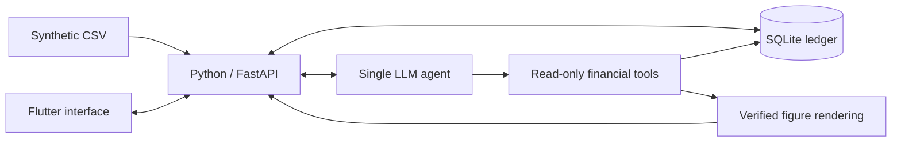

# Shgad (شكد)

An Iraqi Arabic cash-flow assistant for a neighbourhood merchant who tracks cash sales,
customer credit and supplier payments. Shgad aims to turn those records into clear answers
with figures that can be traced back to their source rows.

Built for the Agentic AI Challenge Iraq, Topic 02 (SME & Merchant Assistant).

> **Status: runnable Phase 0 skeleton.** The backend health endpoint and localized Flutter shell work.
> Merchant features below remain planned; no benchmark results or demo dataset exist yet.

## Planned features

- Import synthetic CSV records into a validated SQLite ledger.
- Answer everyday financial questions in Iraqi Arabic, with source evidence for every figure.
- Keep cash, sales, customer debts, supplier bills and owner drawings separate.
- Flag unmatched payments and suspected duplicates for review.
- Summarise the week, including gross margin when cost data is sufficient.
- Project cash flow over the next 30 days, with explicit collection assumptions.

## Merchant questions

These examples describe the intended experience:

| Question | Intended answer |
|---|---|
| عندي فلوس تكفي أدفع للمجهز الخميس؟ | Cash available for a supplier payment, separating confirmed cash from expected collections. |
| منو بعده بذمته فلوس؟ | Outstanding customer debts and their due dates. |
| أكو دفعات ما تطابقت؟ | Unmatched payments and possible duplicates, with explanations. |
| شلون كان شغلنا هالأسبوع؟ | A week-to-date summary of sales, collections, spending and gross margin coverage. |
| الشهر الجاي أكدر أوفي التزاماتي؟ | A cash-flow projection with base and conservative scenarios. |

## Planned architecture



Financial calculations will use integer IQD in Python. The LLM will request validated,
read-only tools and draft explanations with symbolic slots; the backend will fill figures
and dates from verified results. Provider calls and API keys will stay in the backend.

## Development status

The backend requires Python 3.11+ and was verified locally with Python 3.14.7.
From the repository root, create an environment and install the pinned dependencies:

```sh
python -m venv backend/.venv
# Windows PowerShell:
backend/.venv/Scripts/python -m pip install -e 'backend[dev]'
# macOS / Linux: use backend/.venv/bin/python in place of the Windows path.
```

Then, from `backend/`, use that environment's Python:

```sh
python -m pytest -q
python -m ruff check .
python -m ruff format --check .
python -m uvicorn app.main:app --reload
```

Activate the environment first (`.venv/Scripts/Activate.ps1` in PowerShell or
`source .venv/bin/activate` on macOS/Linux). `GET http://127.0.0.1:8000/health`
returns `{"status":"ok","version":"0.1.0"}` without configuration values.
Settings read process environment variables; `.env.example` lists the names.
No `.env` file or provider credentials are needed for health checks. `BUSINESS_AS_OF`
stays unset until explicitly configured; it never defaults to the server date.

The frontend was verified with Flutter 3.44.9 stable and Dart 3.12.2. It contains a static
chat shell, defaults to Arabic RTL, and also supports English LTR. Cairo is bundled with
its license. Backend requests use one Dio client configured with `API_BASE_URL`;
the static shell does not call the backend or any model provider.

From `frontend/`:

```sh
flutter pub get --enforce-lockfile
flutter gen-l10n
dart format --output=none --set-exit-if-changed lib test
flutter analyze
flutter test
flutter run -d chrome --dart-define=API_BASE_URL=http://127.0.0.1:8000
```

To build the web shell with runtime assets served locally:

```sh
flutter build web --release --no-web-resources-cdn --dart-define=API_BASE_URL=http://127.0.0.1:8000
```

The Android target is scaffolded as `com.aw.shgad`, display name «شكد»; Android builds
and release signing have not been verified. Arabic copy is awaiting Iraqi Arabic review.
No merchant chat, import, ledger, forecast or model integration is implemented yet.

Verified locally: 5 backend tests, Ruff lint/format checks, 4 Flutter widget tests
(360×800, Arabic/English, text scales 1.0/1.3), Dart formatting and Flutter analysis.
The health endpoint also returned HTTP 200 from a separate clean checkout. The release
web shell launched in headless Chrome without runtime exceptions; RTL screenshots at
normal and enlarged text sizes were inspected. A separate Dio smoke check reached the
running health endpoint using `--dart-define`.

[GitHub Actions](https://github.com/abdulwahed-s/Shgad/actions/workflows/test.yml)
runs backend lint/format/tests and Flutter localization, formatting, analysis and tests
on pushes and pull requests. Its linked run history shows the measured CI results.
There are no financial benchmarks or model evaluations.

Demo seed/import instructions and a merchant demo remain pending.

## Data and scope

All datasets must be fictional. Real customer and transaction records are outside the scope
of this project. The demo will cover one merchant; payment execution and formal tax/accounting
services are outside the planned MVP.

Application
model/API integration and synthetic data generation remain planned.
